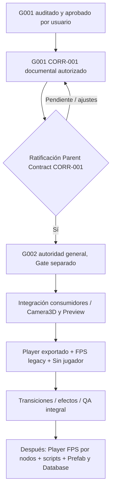

# S15-G001 CORR-001 — Reconciliación documental con auditoría y código vigentes

**Gate:** `LF-CAMERA-ORCHESTRATION-S15-G001-AUDIT-CONTRACT_CORR-001` · 2026-11-09  
**Estado:** auditoría documental correctiva efectuada; contrato padre corregido **RECOMENDADO, pendiente de ratificación**. No prueba código ni Player.  
**Entrada:** SOURCE_BASELINE G001 2.941 archivos. La auditoría original `LF-CAMERA-ORCHESTRATION-S15-G001-AUDIT-CONTRACT_AUDIT.md` se conserva intacta como evidencia histórica.

## A. Qué cambió en la autoridad del contrato

| Aspecto | Propuesta G001 supersedida | Decisión nueva / condición | Prueba de código disponible |
|---|---|---|---|
| Propiedad del sistema | Predominio de Timeline temporal frente a gameplay | Sistema general para solicitantes distintos de Timeline | Actualmente escritores separados; no existe todavía contrato público general |
| Salida por defecto | Retorno a gameplay/FPS al terminar cinemática | **Mantener fuente efectiva válida** en recursos nuevos; compatibilidad legacy | `TimelineRunner._finish()` envía `host.camera(null)`; `_tlCamera()` puede reestablecer base |
| De quién es la cámara | `main`/GameManager/FPS y Timeline en competencia | Camera3D como fuente normal, `main` solo preferencia/fallback legacy | `play-camera.js`, `nodes/camera.js` |
| FilmMaker | Handoff específico Timeline vs FilmMaker | Cinematics consumidor; película `.nfm` mantiene autoría; petición a salida compartida donde proceda | `filmmaker/session.js`, contratos Cinematics/FilmMaker |
| Varios Timelines | Último iniciado gana en general | No extrapolar regla a otros consumidores; propiedad/cesión y desempate expresos | `_tlCamera` busca último Runner válido en `this.tls`; el contrato futuro puede diferir |
| Plantilla FPS | Retorno FPS como consecuencia de liberar Timeline | Separar input de cámara; modernizar personaje FPS en fase posterior | `templates/index.js`, `FpsPlayer.viewPose()`, `database/player.js` |
| Player | Ambigüedad entre jugador y ejecutable | Player exportado participa en S15; personaje FPS por Prefab es **posterior** | `package/game.js` comparte `PlayMode`; no QA funcional aquí |

## B. Clasificación de evidencia

**OBSERVADO:** `src/engine/runtime/events/play-controls.js` escribe cámara en secuencia `this._viewCamera(cam)` → `this._tlCamera(cam)` → `this.film.camera(cam)`; no es un árbitro explícito. `src/engine/runtime/events/play-timeline.js` recorre `tls` para elegir Runner. `src/engine/runtime/timeline/player.js` transmite `null` al terminar.

**OBSERVADO:** `src/engine/runtime/events/play-host.js`/`interpreter.js` exponen `cameraShake`, no se acreditó una API pública genérica de cámara. `src/core/templates/index.js` define First Person `id:'empty'` con sol+Spawn; `src/engine/runtime/player/fps/index.js` usa `PLAYER_DEFAULTS`, `src/engine/runtime/database/player.js` define parámetros de jugador; Prefabs ya tienen operaciones de instanciación y edición (`src/core/state/prefabs.js`).

**INFERENCIA:** la solución óptima puede aprovechar `PlayMode.cam`, evaluadores y nodos existentes para decidir una salida única y permitir solicitudes generalizadas. La viabilidad de scripts/Prefabs FPS sin nuevos métodos de física **no está demostrada**.

**CAUSA RAÍZ ESTÁTICA PARCIAL:** el orden de escrituras permite sobrescritura de pose y cálculos secundarios con cámara anterior; la liberación de Runner a `null` favorece retorno base y no puede conservar automáticamente la nueva política. **No es prueba de reproducción** de las incidencias visuales del usuario.

**NO VERIFICADO:** QA Electron/Player de S15, selección en runtime, conservación de cámara nueva, efectos, API de scripts, FPS prefab, datos en Database después de migración y frames/FPS.

## C. Contradicciones y bloqueos contractuales

1. S11-G002 permite claves heredadas; prohibido sustituir silenciosamente `node`/`free`/`player` por `camera3d` estricto. El fallback editorial observado necesita reproducirse y un Amendment si cambia una semántica ratificada.
2. FilmMaker `.nfm` por ID es autoría propia; Cinematics solo consume importaciones verificadas. No crear cámaras espejo ni cambiar `.nfm`.
3. La política de nueva salida **no convierte los recursos legacy** ni su formato de proyecto sin Gate, revisión y, si procede, Amendment.
4. D03/D04/D06/D09/D12 siguen RECOMENDADAS. Especialmente sin acuerdo sobre interrupción y fuente inválida, G002 no debe proponerse como lista de cambios de producción completamente ejecutables.
5. No declarar que Camera3D, scripts o GameManager ya implementan la interfaz general; el contrato documenta una obligación futura.

## D. Dependencias y secuencia

**Pendientes ajenos conservados:** S13 Inspector G006/G007/G009/G010 → tooltips globales (hover 5 s), optimización global con benchmark antes de refactor, FilmMaker móvil pausado, Terrain, VFX, timeline keyframes, gizmos y demás entradas del ledger. Esta corrección no los cierra ni renumera.

## E. Resultado documental y siguiente acción

- Mantener documentos G001 auditoría y QA sin cambios; no borrar evidencias históricas.
- Sustituir solo la propuesta Parent 001 aún no ratificada por texto CORR-001 con CAM-01..16 y diagramas, distinguiendo decisiones del usuario de recomendaciones D03..D12.
- Registrar en las seis hojas la autorización CORR-001, estado RECOMENDADO del Parent y la aprobación documental de G001 por el usuario sin declarar ejecución QA de cámaras.
- Pedir ratificación/ajustes específicos al contrato; **G002 sigue NO AUTORIZADO**.
