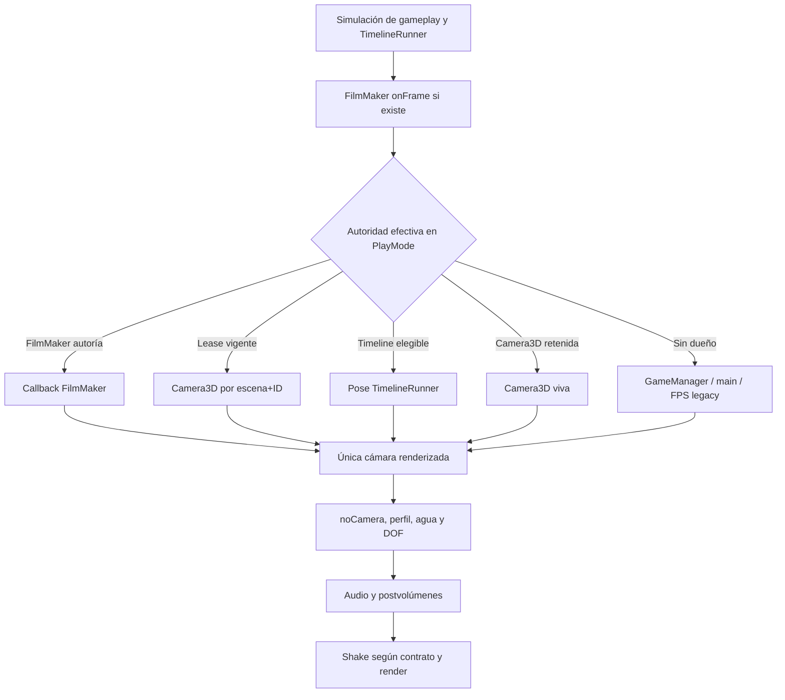
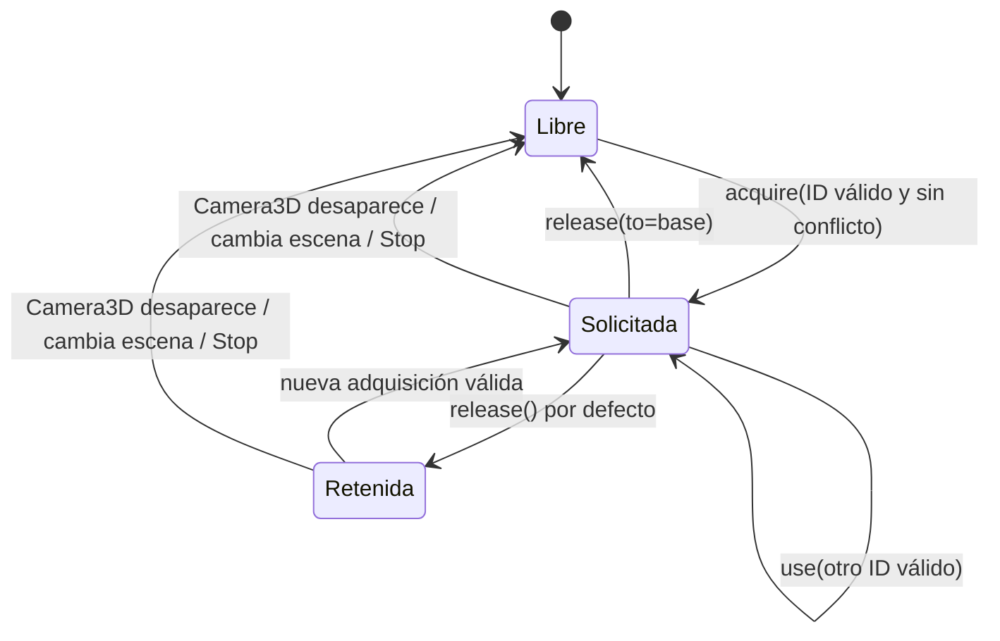

# LevelForge — S15-G002 · Autoridad nativa de cámaras

**Gate autorizado:** `LF-CAMERA-ORCHESTRATION-S15-G002-NATIVE-AUTHORITY` (2026-11-09).  
**Parent Contract:** `LF-CAMERA-ORCHESTRATION-S15-PARENT-CONTRACT-001` (CORR-001, ratificado por el usuario tras revisión).  
**Entrada:** `LF_CAMERA_ORCHESTRATION_S15_G001_AUDIT_CONTRACT_CORR001_SOURCE_BASELINE.zip` (2.944 archivos).  
**Estado:** IMPLEMENTADO EN FUENTES; NODE AISLADO 15/15 PASS; REGRESIÓN NODE 78/78 PASS; QA local Electron y runtime exportado **NO VERIFICADOS**; **NO CERRADO**.

## OBSERVADO en la fuente anterior

- `play-controls.js` escribía cámara base, Timeline y finalmente FilmMaker en un mismo frame; agua/DOF se procesaban en `_viewCamera` antes de la vista cinematográfica y audio también recibía la pose anterior.
- `play-camera.js` decidía `noCamera` antes de comprobar muestras válidas de Timeline; la plantilla `Sin jugador` podía ocultar la imagen pese a una cámara cinematográfica.
- `_tlCamera` restablecía `g.fov` después de una toma incluso si la Camera3D principal tenía otro FOV.
- `_eyeRay` escribía sobre `this.cam` (la salida de render), aunque su intención era consultar una mirada de gameplay.
- El runtime exportado importa `PlayMode`. El Editor Preview usa `TimelinePreview` separado y sigue teniendo sus propios modos heredados.

## Implementación acotada

Se **extiende** `cameraMethods` dentro de `PlayMode`: `_cameraFrame` elige una sola fuente efectiva y la aplica antes de agua, DOF, audio, volúmenes, interacción, LOD y Shake. No se añadió bucle, árbol de cámaras, `CameraManager`, nuevo dato de proyecto ni copia de Cinemachine. Cada PlayMode conserva su única autoridad independiente de los demás contextos.

- **Base:** GameManager Camera3D o `main` activa; en ausencia, `player.viewPose()` heredado. La plantilla FPS actual NO se altera.
- **Solicitudes nuevas de scripts:** `game.camera.acquire(cameraId)` acepta exclusivamente ID Camera3D de escena activa; retorna un lease o `null` si falta cámara o autoridad incompatible. `lease.use(otroId)` cambia la Camera3D dentro del mismo lease. `lease.release()` mantiene la Camera3D viva, reevaluando su transform/FOV/perfil; `lease.release({ to: 'base' })` devuelve explícitamente la base.
- **Concurrencia:** una solicitud con lease activo conserva su salida frente a una Timeline iniciada después. Con Timeline con muestra ya activa o FilmMaker ya activo, se rechaza la nueva adquisición y se registra diagnóstico una sola vez por tipo de conflicto. Entre varias Timelines se conserva el desempate histórico interno de ese consumidor; no se inventó una prioridad persistente.
- **Timeline heredado:** mantiene su contrato de `TimelineRunner` y salida en `null` al terminar. La retención declarativa para *nuevos recursos Timeline* y políticas `stop/skip/seek` quedan pendientes de G003/G006; este Gate no inventa columnas de persistencia ni convierte recursos existentes.
- **FilmMaker:** en su contexto de autoría conserva control de la vista; `.nfm` y su callback de cámara no cambian. Si coincide con Timeline, prevalece FilmMaker con diagnóstico, no por escribir después.
- **Sin jugador:** solo se declara `noCamera` tras arbitrar. Una Camera3D pedida por script, una muestra de Timeline o FilmMaker válida permite mostrar la imagen.
- **Fuente perdida:** por desaparición, visibilidad falsa o cambio de escena se invalida el lease; se devuelve una fuente disponible o `SIN_CAMARA`, con diagnóstico, sin reutilizar IDs de otra escena.
- **Efectos:** Shake usa la fuente efectiva, pero continúa excluido para Timeline y FilmMaker según política legacy. No se implementan nuevos blends, perfil dual ni Shake cinematográfico.
- **API expuesta:** `game.camera` en el intérprete de scripts y host existentes, con tipos sincronizados en `src/core/events/game-api.d.ts` y `vscode-extension/media/game-api.d.ts` para IntelliSense de VS Code; comandos visuales para eventos todavía requieren diseño posterior. No se cambió Database ni el Player de la plantilla FPS.

### Diagrama de una evaluación de frame

### Ciclo de vida del lease

## Alcance expresamente pendiente

1. G003: controles de Timeline/Preview/recursos nuevos con política de salida editable, API de eventos y referencias completas, según declaración futura.
2. G004: paridad del runtime exportado y plantillas existentes, con QA del usuario.
3. G005: selección y gizmos de Camera3D.
4. G006: cortes, blends, prioridad explícita si se ratifica, interrupción, recuperación, FOV/perfiles y Shake cinematográfico.
5. G007: QA integral; después, sin numerar, personaje FPS en nodos/scripts/Prefab con Database.

**OBSERVACIÓN DE DEUDA:** la estructura de Timeline sigue utilizando el desempate histórico interno de último Runner con pose; esto no establece precedencia general de todos los consumidores. Las APIs de recursos cinematográficos todavía no persisten la política nueva. No registrar como COMPLETO hasta sus Gates.

## Regresiones afectadas y compatibilidad

Se actualizaron dos **aserciones estáticas** y se corrigió la inyección de dependencias de un harness histórico, sin modificar audio de producción: `G004-16` en `scripts/test-cinematics-player-integration-s05-g004.mjs`, y `PV-28` en `scripts/test-post-s01-g002.mjs`. Antes comprobaban literalmente `_viewCamera→_tlCamera` en `play-controls.js`. Ahora comprueban que la resolución unificada `_cameraFrame` preceda al uso de la vista efectiva y que siga pudiendo aplicar Timeline. En G004-20 el harness ya eliminaba el import de `resolveAudioGroup` pero no inyectaba ese resolvedor, causando un FAIL preexistente; ahora utiliza la función productiva desde `audio/config.js`. No se eliminaron aserciones. La ejecución conjunta de G002, G004, PostVolume y VS Code suma **78/78 Node PASS**.

**CAUSA RAÍZ TOTAL DE LA INCIDENCIA EN QA REAL:** NO VERIFICADA. El código previo acredita escritores secuenciales y visibilidad prematura, pero la reproducción visual debe confirmarla el usuario.
