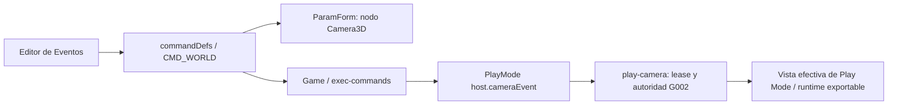

# LevelForge — S15-G003 · Consumidor nativo de cámaras desde eventos

**Gate:** `LF-CAMERA-ORCHESTRATION-S15-G003-EVENT-CAMERA-CONSUMER`  
**Autorización literal:** confirmada por el usuario, 2026-11-09.  
**Parent Contract:** `LF-CAMERA-ORCHESTRATION-S15-PARENT-CONTRACT-001`, CORR-001 ratificado.  
**SOURCE_BASELINE de entrada:** `LF_CAMERA_ORCHESTRATION_S15_G002_NATIVE_AUTHORITY_SOURCE_BASELINE.zip`.  
**Estado:** IMPLEMENTADO EN FUENTES; Node específico 18/18 PASS; conjunto focal 139/139 PASS; **BUILD/QA ELECTRON/RUNTIME EXPORTADO NO VERIFICADOS EN ESTE ENTORNO**. **NO APROBADO / NO CERRADO**.

## 1. Auditoría previa

- `src/engine/runtime/events/commandDefs.js` agrega `CMD_WORLD` y genera comandos con `newCommand`; `src/components/EventEditor.vue` genera el editor utilizando `ParamForm.vue`.
- `ParamForm.vue` ya dispone de tipo `node` con filtro `only: ['camera']` que utiliza los IDs reales de `project.objects`, sin crear un selector alternativo.
- `exec-commands.js` ejecuta comandos sobre el `host` del intérprete `Game`; `play-host.js` enlaza esa interfaz con `PlayMode`.
- G002 implementó `_cameraAcquire` y el lease `{use, release}` en `play-camera.js`. `_cameraSource` es la autoridad de salida exclusiva del contexto. Los comandos visuales **no** deben crear otra fuente de verdad.
- Los eventos comunes se invocan por registros de Database con ID y nombre (`callCommon`); usar el nombre como propietario generaría colisiones entre registros homónimos.

## 2. Implementación real

**Nuevo comando `cameraControl` en grupo «Mundo»:**

| Acción | Uso | Regla |
|---|---|---|
| Activar Camera3D | Selecciona un nodo Camera3D de la escena con el selector existente | Si no hay solicitud incompatible, adquiere la vista; si el mismo evento ya tiene lease, puede cambiar de cámara |
| Cambiar Camera3D del evento | Selecciona otra Camera3D | Exige un lease activo propio; no toma control desde otro evento ni script |
| Liberar · mantener Camera3D | Conserva la fuente viva y reevaluada | La cámara sigue funcionando hasta que un consumidor autorizado la cambie o desaparezca |
| Liberar · volver a base | Descarta la solicitud | Regresa a la fuente base existente (GameManager/main/FPS heredado), sin suponer que siempre hay un jugador |

- Los parámetros se serializan en el **modelo existente** del comando (`{id, code, p, b}`), sin añadir campos raíz en proyecto, escena, Timeline o Database.
- El host expone la operación interna `cameraEvent` hacia `_cameraEventControl`, que utiliza el lease real G002. El propietario se almacena **únicamente en `_cameraSource`**, junto al token y el lease del consumidor de evento; no hay `CameraManager`, lista de solicitudes, bucle adicional ni estado persistente duplicado.
- Evento de escena: el propietario es `event:<eventId>`. Evento común: es `common:<id>` del registro Database, pasado a `run` en el contexto de ejecución. Dos eventos comunes homónimos conservan identidades distintas.
- Un comando inválido o rechazado produce `EventError` y utiliza el canal de errores convencional del intérprete. No desplaza la autoridad vigente.
- Las reglas G002 de arbitraje, fuente perdida, cambio de escena y compatibilidad con Timeline/FilmMaker siguen siendo vinculantes. Los scripts continúan usando `game.camera.acquire` sin cambios.
- El fin natural de un evento no fuerza el regreso al FPS. La liberación debe solicitarse explícitamente si se quiere cambiar la cámara; `keep` conserva una Camera3D viva.

## 3. Integración

El runtime exportable comparte el código de `PlayMode`; **compilar o reutilizar la clase no demuestra** que un juego exportado se haya ejecutado. Se requiere QA independiente.

## 4. Riesgos y límites conocidos

- La política de conflictos de G002 sigue siendo conservadora: no existe un sistema nuevo de prioridades implícitas. Un evento externo no puede cambiar/liberar el lease de otro; el comando debe manejarse como error de autoría y corregirse en el recurso.
- Cambiar/lanzar otro evento común que no sea el propietario tampoco puede liberar su lease. Si se necesita transferencia entre propietarios distintos, se definirá de forma explícita en un Gate posterior. No se comparte autoridad por nombre.
- El comando G003 no configura políticas de salida dentro de Timeline, ni cortes/blends, Shake cinematográfico o las prioridades futuras.
- La plantilla FPS heredada y su Database no han sido modificadas. La sustitución posterior del personaje FPS por nodos/scripts/Prefab es otro trabajo.
- La cámara editorial de navegación no se registra como Camera3D en el selector.

## 5. Clasificación de evidencia

**OBSERVADO EN CÓDIGO:** configuración declarativa, selección filtrada por tipo, host existente, autoridad G002 compartida y reinicio por cambio de escena.  
**IMPLEMENTADO:** comando visual y ruta de ejecución a lease existente; identidad de evento común por ID.  
**TEST AUTOMATIZADO PASS:** 18 pruebas específicas y 139 pruebas en conjunto focal.  
**BUILD:** NO VERIFICADO (no existe instalación de `vite` en el entorno de auditoría).  
**QA LOCAL/PLAYER EXPORTADO:** NO VERIFICADO para G003.  
**CIERRE:** pendiente de QA, aprobación del usuario y actualización posterior del ledger.
