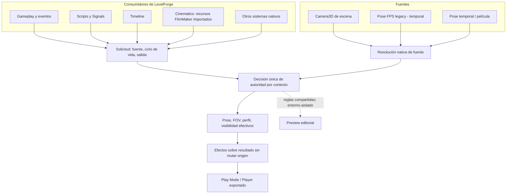
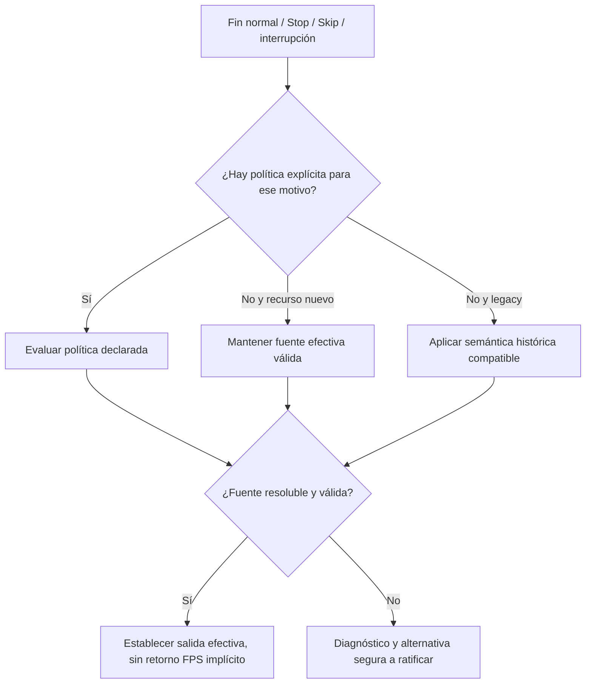
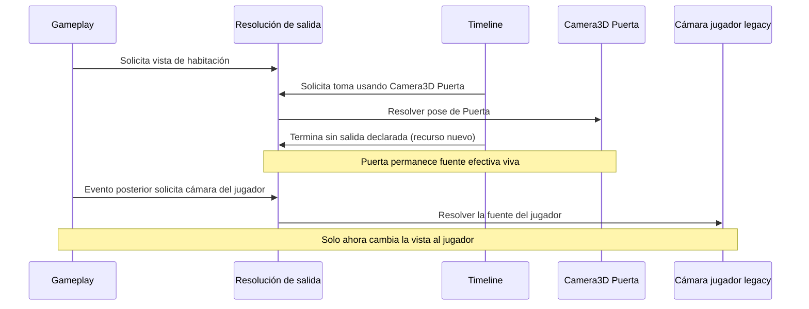

# LevelForge — S15 Camera Orchestration · Parent Contract 001

**Identificador:** `LF-CAMERA-ORCHESTRATION-S15-PARENT-CONTRACT-001`  
**Versión documental propuesta:** CORR-001, 2026-11-09.  
**Estado de CORR-001:** **RATIFICADO POR EL USUARIO el 2026-11-09**, según declaración posterior a la entrega; este encabezado se reconcilia documentalmente. **CA-001 pre-LTS RATIFICADO por el usuario 2026-11-09**.  
**Gate que permite esta corrección:** `LF-CAMERA-ORCHESTRATION-S15-G001-AUDIT-CONTRACT_CORR-001`, autorizado literalmente el 2026-11-09.  
**SOURCE_BASELINE de entrada:** `LF_CAMERA_ORCHESTRATION_S15_G001_AUDIT_CONTRACT_SOURCE_BASELINE.zip` (2.941 archivos).  
**Antecedente preservado:** G001 original aprobado por usuario, `LF-CAMERA-ORCHESTRATION-S15-G001-AUDIT-CONTRACT_AUDIT.md`.  
**Referencia conceptual únicamente:** Cinemachine 3.1.8-pre.2; no copiar clases, assets ni código con Unity Companion License.

> **SUPERSESIÓN DOCUMENTAL:** esta versión sustituye **íntegramente la propuesta no ratificada** del Parent Contract 001 entregada en G001. La auditoría estática original permanece como evidencia histórica, no se alteran contratos anteriores aprobados. El texto CORR-001 tampoco se convierte en contrato vinculante antes de ratificación expresa.

## Aviso de Amendment pendiente — política pre-LTS de nodos

El Gate documental `LF-CAMERA-ORCHESTRATION-S15-G003-CORR-002-PRELTS-CONTRACT-AMEND-G001` aporta la **propuesta no ratificada** `LF-NODE-ACTIVE-VISIBLE-PRELTS-CA-001` (en `docs/architecture/LF-NODE-ACTIVE-VISIBLE-PRELTS-CA-001_AMENDMENT.md`). El usuario descartó migrar `visible` a `active` y ejecutar pruebas históricas durante CORR-002. CAM-15 y cualquier obligación de compatibilidad histórica aplicable a esa separación **quedan sustituidas en el alcance delimitado de CA-001 ratificado**. CA-001 ratificado sustituye solamente las obligaciones retrospectivas aplicables a active/visible. Los demás contratos y sistemas vigentes permanecen vinculantes; CORR-002 se reanudó bajo la autorización literal CONT-001. 

## 1. Decisiones del usuario — fuente de autoridad, no implementación

| ID | Decisión comunicada el 2026-11-09 | Condición |
|---|---|---|
| U-01 | Camera Orchestration es **nativa y general del motor**, disponible para gameplay, eventos, scripts, Timeline, Cinematics y cualquier otro consumidor válido. | No pertenece a Timeline ni a la plantilla FPS. |
| U-02 | Los recursos nuevos que terminen **sin política de salida** mantienen la **cámara efectiva válida**; nunca vuelven implícitamente al jugador. | Distinguir cámara viva de última pose congelada; compatibilidad legacy aparte. |
| U-03 | El propio recurso podrá indicar qué cámara sigue al finalizar, incluida expresamente la del jugador si se desea. | Los campos y comandos exactos todavía no existen: requerirán diseño, Gate y QA. |
| U-04 | Modernizar **después** el jugador de la única plantilla FPS utilizando nodos, scripts y Prefab existentes, con Camera3D ordinaria. | No forma parte del primer Gate de cámaras. Conservar `FpsPlayer` legacy hasta verificar paridad. |
| U-05 | El Player del personaje FPS toma valores específicos de Database. | Auditar y conservar esos datos/APIs; no duplicar registros ni asignar configuración ficticia. |
| U-06 | Primero orquestación y QA integrado de cámaras, **luego** modernización de plantilla FPS. | Player exportado SÍ se prueba durante S15, sin esperar modernización. |

La propuesta antigua «al terminar Timeline recuperar siempre gameplay/FPS» queda **SUPERSEDIDA para recursos nuevos**. Para proyectos antiguos conserva prioridad el contrato de compatibilidad vigente, sin migraciones destructivas implícitas.

## 2. Modelo conceptual y términos

- **Fuente:** Camera3D nativa (`type:'camera'`, ID y escena), la pose de un controlador legacy FPS, una pose de un recurso temporal o una fuente adaptada con identidad verificable. Una fuente aporta posición, orientación, FOV/eje y perfil cuando corresponda; **no** decide unilateralmente que el render la utilice.
- **Consumidor/solicitante:** sistema de gameplay, script, evento, Timeline, Cinematics importado, o subsistema nativo que pide activar, ceder, mantener o cambiar una fuente.
- **Autoridad:** decisión efectiva por **contexto de render** sobre qué fuente o mezcla produce la vista. No equivale a `Camera3D.main`, al orden de escritura ni al bloqueo de input.
- **Recurso:** entidad que originó una solicitud y, cuando se apruebe la interfaz, podrá declarar una **política de salida**. No confundir duración del Timeline con duración indefinida de la cámara posterior.
- **Salida efectiva:** pose y FOV/proyección, perfil, visibilidad y efectos realmente consumidos por render, audio espacial, DOF, agua y demás lectores relacionados.
- **Camera3D viva:** su pose se vuelve a resolver mientras exista y sea válida; **pose retenida:** instantánea visual independiente de movimiento posterior (opción distinta, no sinónimo de «mantener cámara»).

### 2.1. Flujo general (arquitectura objetivo, no implementación)

**Restricción:** los rectángulos representan responsabilidades lógicas. No autoriza un `CameraManager` global, un Brain copiado de Unity, múltiples loops ni una nueva jerarquía de Camera3D. Extender `PlayMode.cam`, `TimelineRunner`, `TimelinePreview`, GameManager y adaptadores existentes primero.

## 3. CAM-01 a CAM-16 — contrato padre CORR-001 ratificado por el usuario

**CAM-01 — Independencia del consumidor.** Cualquier sistema autorizado puede **solicitar** una cámara; Timeline no es dueño del servicio, la cámara FPS tampoco. Las solicitudes públicas para scripts/eventos todavía son **capacidad futura**, no API observada.

**CAM-02 — Autoridad única efectiva por contexto.** Play Mode, Player exportado y Preview tienen una decisión efectiva cada uno; no permiten sobrescrituras competitivas en el mismo fotograma. Preview conserva aislamiento editorial.

**CAM-03 — Cámara como fuente, no como autoridad.** Camera3D puede servir gameplay, escena fija, vigilancia o Timeline con ID/escena; GameManager y `main` siguen como selector legacy/base, sin competir contra una solicitud ganadora.

**CAM-04 — Salida definida por el recurso.** Para **recursos nuevos** sin declaración de salida: mantener la **última fuente efectiva válida**, reevaluándola mientras exista; **no** recuperar implícitamente FPS ni base. El recurso puede declarar un cambio a Camera3D, fuente anterior, cámara jugador o pose retenida. Si la fuente deja de existir, aplicar la regla segura y diagnosticada de CAM-11, aún pendiente de concretar; no teletransportar personajes ni inventar pose.

**CAM-05 — Identidad y referencias.** Resolver Camera3D existente con escena+ID; respetar jerarquía y transformaciones mundiales. Identidades homónimas no se resuelven por nombre. Modos legacy `free`/`node`/`player`/`camera3d` mantienen compatibilidad previa hasta Amendment aprobado.

**CAM-06 — Control distinto de vista.** `lock` de Timeline, input FPS, mirada y movimiento no implican cambio de cámara. Liberar el movimiento no devuelve por defecto la vista al jugador. No alterar transform del jugador para restaurar un plano.

**CAM-07 — Player exportado y runtime.** Play Mode y Player exportado comparten resolución, semántica de solicitudes, escenas, FOV, perfiles, salida y persistencia. Verificación de paquete real independiente de compilación.

**CAM-08 — Preview y editor.** `vp.persp` es navegación, no fuente gameplay improvisada. Preview mantiene render/cámara temporal seguros y recupera el contexto editorial; scrub no despacha scripts/audio/eventos.

**CAM-09 — EXTEND BEFORE DUPLICATE.** Integrar responsabilidades en evaluación y render existentes (`PlayMode`, `TimelineRunner`, evaluador, Camera3D, GameManager, sistemas de efectos). No nuevo Brain/CameraManager paralelo, service locator global, estados redundantes ni loops extra sin evidencia y autorización específica.

**CAM-10 — Ownership de FilmMaker/Cinematics.** FilmMaker sigue autorando `.nfm`; Cinematics consume películas importadas según contratos S05. Una pose de película es una **solicitud/fuente adaptada**, no un espejo Camera3D ni permiso para reescribir `.nfm`. Contextos de autoría siguen aislados; resolver posibles disputas de salida con contrato explícito (D03), nunca con última escritura silenciosa.

**CAM-11 — Pérdida de fuente/visibilidad.** El resultado `SIN_CAMARA` se decide **después** del arbitraje. En plantilla Sin jugador, una cámara válida de cualquier consumidor debe poder producir imagen. ID eliminado, escena distinta, source sin pose, cambio de escena y fallback deben quedar diagnosticados y ser deterministas; la alternativa específica para nuevas solicitudes inválidas requiere ratificación en Gate de detalle.

**CAM-12 — Cortes, blends, FOV y perfiles.** Cortes aplican un resultado completo; blends conservan coordenadas, orientación, FOV con conversión de ejes y perfil determinista. Duraciones, interrupciones, origen de blend y selector de perfil son decisiones D12 pendientes, no formatos ya implementados.

**CAM-13 — Efectos posteriores.** Shake, Camera Motion, DOF, agua y audio espacial evalúan la salida efectiva sin mutar pose persistida ni duplicar sacudidas horneadas. Opt-in cinematográfico D09 requiere definición; conservar conducta legacy hasta Gate autorizado.

**CAM-14 — Ciclo de vida y concurrencia.** Adquisición, elegibilidad, cesión, interrupción, pause, resume, seek, loop, stop, skip, fin, scene switch, destrucción y restauración de sesión tienen transiciones explícitas. La carrera «último escritor gana» queda descartada como contrato. Concurrencia D04 pendiente de regla final ratificada.

**CAM-15 — Compatibilidad y rendimiento.** No romper `.lfproj`, Player, FPS legacy, GameManager, Camera3D, escenas, Jolt, FilmMaker, Cin, clips o proyecto antiguo. Sin refactor global ni prioridades persistentes especulativas. Medir frame time p50/p95, FPS y recursos antes de afirmar eficiencia.

**CAM-16 — QA y aprobación.** Gate funcional requiere Node, Electron embebido, build Editor/Player, ejecución Player exportado, regresiones y QA local del usuario según alcance. Distinguir IMPLEMENTADO / TEST PASS / COMPILADO / QA LOCAL PASS / APROBADO / CERRADO. Documento y build no son QA visual.

## 4. Contrato de salida propuesto (no es modelo serializado actual)

| Acción de salida conceptual | Semántica obligatoria si se ratifica | Riesgo a resolver en Gate específico |
|---|---|---|
| `mantener_fuente` (predeterminada en recurso **nuevo**) | Mantiene Camera3D/fuente efectiva viva sin cambio implícito. | Disponibilidad, validez entre escenas, destrucción. |
| `activar_camera3d` | Resuelve ID y escena concretos y toma su transformación actual. | Referencia huérfana, perfil, latencia, transición. |
| `recuperar_anterior` | Solicita fuente anterior válida **solo porque el recurso lo declaró**. | Determinar histórico de autoridad por contexto; no stack global duplicado. |
| `activar_jugador` | Solicita la fuente del jugador existente de forma explícita. | Sin jugador, cámara FPS legacy y evolución futura. |
| `mantener_pose` | Retiene fotografía visual (pose, FOV, perfil) sin seguir transform del nodo. | Memoria/vida de snapshot y cambios de escena. |

**No se define ni autoriza** añadir una propiedad `exitCamera`, un enum persistente, comando público o cambio de formato durante este Gate documental. Cualquier nueva interfaz deberá pasar por Gate técnico y, si contradice contratos vigentes, Contract Amendment.

### 4.1. Fin de recurso nuevo

La política de salida por **motivo** (fin natural, stop, skip, interrupción, destrucción) está pendiente de definición; el diagrama no equipara sus efectos automáticamente. La selección del fallback de fuente perdida es **bloqueo de diseño**, no un comportamiento aprobado.

### 4.2. Ejemplo: cinemática termina pero el juego conserva otra Camera3D

## 5. Decisiones D03, D04, D06, D09 y D12 — RECOMENDADAS, NO RATIFICADAS

| ID | Propuesta revisada tras decisiones del usuario | Bloqueo antes de Gate técnico |
|---|---|---|
| **D03** | Solicitudes del juego, Timeline y Cinematics entran en **resolución común por contexto**; autoría FilmMaker `.nfm` y rodaje aislados; transferencia explícita donde se permitan contextos compartidos. | Definir quién puede solicitar/preemptar, sin alterar CA de FilmMaker ni APIs existentes. |
| **D04** | No imponer «último Timeline iniciado gana» a todo LevelForge. Recomendada: propietario efectivo conserva autoridad mientras sea válida salvo cesión/interrupción **explícita**; conflictos simultáneos se rechazan/difieren con diagnóstico y desempate estable. Dentro de un Runner preservar última pista válida S10. | Especificar adquisición, reentrancia, orden de solicitudes y anidamiento; comprobar escenarios legacy antes de cambiar semántica. |
| **D06** | `lock=true` solicita suspender movimiento **y** look; `lock=false` no los suspende. Restitución de input independiente de la cámara; **no** retorno FPS automático. | Contrato de pointer lock, múltiples locks, pausas y jugador ausente; sin reescribir FPS ahora. |
| **D09** | Conservar por compatibilidad desactivación actual del Shake externo durante toma; futura composición cinematográfica **explícita** y no destructiva, evitando Shake duplicado en película. | Identificar destino, tiempos, efectos horneados y QA de opt-in antes de activarlo. |
| **D12** | Cortes de pose/FOV/perfil atómicos; blends de pose/quaternion/FOV en eje común; perfil discreto por fuente de peso dominante como **opción a ratificar**, no doble posprocesado por defecto. | Duración, evaluación de pesos, interrupciones, perfil de empate y persistencia se especificarán en Gate de transiciones. |

Los principios generales del Parent CORR-001 fueron ratificados por el usuario. Los detalles abiertos de D03/D04/D06/D09/D12 (preempción, fallback, perfil e interrupción) continúan sujetos a los Gates de implementación correspondientes; no fingir que se aprobaron interfaces que aún no se especificaron.

## 6. Fotografía estática de G001 CORR-001 (histórica; no representa el runtime posterior a G002/G003)

- `src/engine/runtime/events/play-controls.js`: actualmente `_viewCamera` → `_tlCamera` → `film.camera` (varios escritores). `audio.update` y algunos efectos evalúan antes de la última cámara.
- `src/engine/runtime/events/play-camera.js`: GameManager por ID, luego `main`, luego `player.viewPose`; marca `noCamera` antes de Timeline.
- `src/engine/runtime/events/play-timeline.js`: por defecto releva cámara de Timeline al terminar; `_tlCamera()` selecciona Runner por orden actual. No existe política general de salida definida por recurso.
- `src/engine/runtime/timeline/player.js`: `host.camera(null)` al terminar, sin contrato de fuente retenida. Esto **no** cumple por sí solo U-02.
- `src/core/timeline/preview.js`: Preview temporal/editorial; ciertos modos heredados pueden recuperar `vp.persp`.
- `src/engine/runtime/events/play-host.js` e `interpreter.js`: API pública `cameraShake` observada; **no está acreditada una API general `game.camera` de selección/activación**. Es una capacidad futura que deberá diseñarse.
- `src/filmmaker/session.js`: reproducción de entorno FilmMaker usa callback de cámara editorial; preservar ownership.
- `src/engine/runtime/package/game.js`: Player exportado usa PlayMode compartido; equivalencia visual aún no verificada.

**Alcance de la fotografía:** refleja la auditoría original; G002 fue implementado y aprobado posteriormente por el usuario, G003/CORR-001 entregados con QA pendiente. Este apartado no invalida ni reemplaza sus pruebas y evidencias posteriores.

## 7. Plantilla FPS — DESPUÉS de Camera Orchestration

La **única** plantilla `First Person` (ID histórico `empty`) crea actualmente sol+Spawn y utiliza `FpsPlayer.viewPose()`; el personaje no es todavía un Prefab jerárquico con Camera3D. `src/core/state/prefabs.js` demuestra que existen creación, instanciación y sincronización de Prefabs, pero **no** demuestra paridad de Jolt/locomoción/scripts.

La futura evolución del **personaje Player FPS** debe auditar y preservar `src/engine/runtime/database/player.js` (`PLAYER_DEFAULTS`, `MOVE_KEYS`), cuerpo Jolt, controles, manos/slots, pasos, agua, Camera Motion, scripts, saves y APIs `game.player`. Reutilizar Prefabs, scripts y Camera3D reales, sin motor de personaje duplicado. No eliminar `FpsPlayer` antes de verificar paridad y QA del funcionamiento **vigente**. La obligación retrospectiva de proyectos antiguos está pendiente de reconciliación mediante CA-001.

**Distinción:** el **Player exportado** debe recibir y pasar QA de cámaras dentro de S15; **modernizar el personaje FPS de la plantilla** es una fase posterior sin Gate autorizado ni sprint nuevo numerado.

## 8. Secuencia originalmente propuesta (registro histórico; estado posterior por Gate)

| Unidad | Alcance previo sugerido revisado | Condición |
|---|---|---|
| G002 | Autoridad general nativa de cámaras: arbitraje por contexto y salida efectiva sin writers competitivos; interfaz de consumidores **solo** tras definir/ratificar mecanismos. | Ratificar Parent y D03/D04; fijar política de fuente inválida y alcance técnico exacto. |
| G003 | Integraciones Camera3D y consumidor Timeline/Preview, sin rehacer S11-G002; eventos/scripts según contrato público aprobado. | G002 y compatibilidad legacy. |
| G004 | Play Mode y Player exportado, plantilla FPS **actual** y Sin jugador; paridad y seguridad de salida. | G002/G003; no modernizar personaje FPS aquí. |
| G005 | Selección Camera3D y gizmos existentes; integración sin interferencia temporal. | Reproducción de regresiones/editor. |
| G006 | Cortes, blends, perfiles, FOV, shake y políticas de finalización/interrupción. | Contrato de datos y D09/D12. |
| G007 | QA integral de cámara, Editor/Play/Player, proyectos legacy y rendimiento medido. | Gates previos; QA local del usuario. |
| Posterior, **sin numerar** | Evolución del jugador plantilla FPS basado en nodos/scripts/Prefab + Database. | Camera Orchestration funcional y QA; contrato y Gate propios. |

**Estado reconciliado al 2026-11-09:** G002 APROBADO por usuario (Node y compilación, QA local Timeline/Play Mode); G003 implementado con QA pendiente; G003 CORR-001 entregado con QA pendiente; G003 CORR-002 interrumpido y BLOQUEADO por contradicción documental; G004–G007 no autorizados. La tabla anterior conserva la planificación original, no sustituye los Gates reales. Inspector S13 G006/G007/G009/G010, tooltips post-QA Inspector y Sprint de optimización siguen pendientes independientes.

## 9. Ratificación, contradicciones y cierre

- La propuesta G001 original es **SUPERSEDIDA solo en lo que era una propuesta no ratificada**; la auditoría histórica y contratos S10/S11/Cinematics/FilmMaker/Player/Database siguen vinculantes.
- Cualquier regla ratificada de estos contratos que contradiga un cambio requerido bloquea ese **Gate de implementación**, exigiendo Contract Amendment explícito. No adaptar contratos para justificar bugs.
- El usuario debe revisar CAM-01..16 y decisiones D03/D04/D06/D09/D12, en especial política de interrupción, fuente inválida y perfiles. Si una decisión permanece abierta, no autorizar el Gate técnico dependiente.
- El Parent CORR-001 fue ratificado; G002 fue aprobado por usuario con pruebas Node/build y QA local de Timeline/Play Mode. G003 y su CORR-001 no están cerrados. CA-001 pre-LTS ratificado posteriormente; CORR-002 CONT-001 autorizado y en implementación, sujeto a QA local.

**Siguiente acción real a 2026-11-09:** revisión/ratificación del Contract Amendment `LF-NODE-ACTIVE-VISIBLE-PRELTS-CA-001`; después nueva autorización técnica para reanudar CORR-002, sin introducir migraciones históricas. G004 sigue sin autorización.
