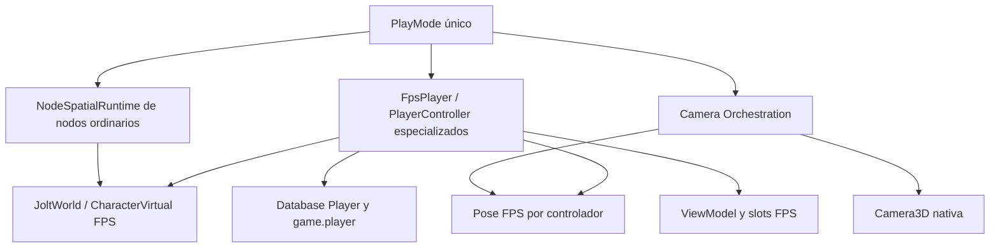
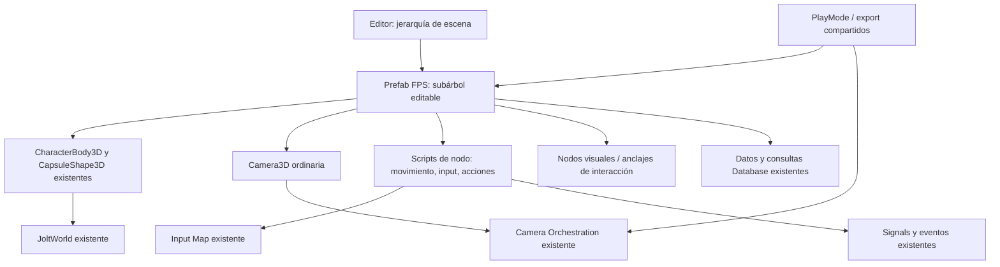

# LevelForge — S16 FPS Native Player · Contrato arquitectónico propuesto

**Gate:** `LF-FPS-NATIVE-PLAYER-S16-G001-AUDIT-CONTRACT` (autorización literal recibida).  
**Fecha:** 2026-11-11, America/Santo_Domingo.  
**Autoridad:** decisión expresa del usuario: el FPS es una composición ordinaria editable desde el Editor, no un segundo sistema de jugador.  
**Estado del presente documento:** PROPUESTA TÉCNICA, pendiente de aprobación del usuario. **No es Contract Amendment ratificado.**  
**Baseline:** `LF_LEDGER_CONTINUITY_S00_G001_INTEGRAL_RECONCILIATION_SOURCE_BASELINE.zip`.

## Contrato funcional aprobado por decisión del usuario

- Un jugador FPS debe construirse/modificarse íntegramente desde el Editor usando nodos, scripts y componentes nativos; **ningún tipo de jugador especial obligatorio**.
- La plantilla FPS es una **composición reutilizable de nodos / Prefab**, no un controlador que ejecuta un motor alterno.
- Una sola autoridad por responsabilidad: `CharacterBody3D`/Jolt para cuerpo, `Camera3D`/Camera Orchestration para cámara, `Input Map` + scripts para acciones, Signals/eventos para interacción, Prefabs para reutilización, Database para datos.
- Un solo `PlayMode`, un solo mundo Jolt y un solo ciclo de vida de nodos. Editor Play y Player exportado comparten semántica. Nunca crear un segundo Game/Physics/Input/Camera Manager.
- Preservar el contrato externo consumido por juegos (`game.player`, `game.viewModel`, scripts y eventos), datos autorales, escenas y cambios locales. Las rutas legacy **no se eliminan** hasta demostrar paridad completa y aprobar su retiro. Esto NO autoriza una capa adaptadora permanente o duplicar estado.
- Camera Orchestration S15 y Timeline CA-005 siguen vinculantes. Ningún cambio de prioridad implícita, restauración de cámara ni dependencia de selección editorial.

## Estado OBSERVADO en el SOURCE_BASELINE

1. `src/engine/runtime/player/index.js`: `DEFAULT_PLAYER = FpsPlayer.id`, `createPlayer()` crea una subclase de `PlayerController`; `none` también es un controlador. `src/components/GameManagerEditor.vue` presenta el selector de tipos.
2. `src/engine/runtime/events/play.js`: PlayMode instancia el controlador y reenvía `begin`, `frame`, `update`, `late`, `viewPose`; el estado físico FPS y la cámara dependen de éste. `src/engine/runtime/events/play-player.js` expone accesores/acciones por delegación.
3. `src/engine/runtime/player/fps/`: locomoción, mirada, cámara, pasos, cámara-motion, manos/slots, lanzamiento/inventario y agua tienen estado y métodos propios.
4. `src/engine/runtime/nodes/physics.js` registra `CharacterBody3D` y `CollisionShape3D`; `src/engine/runtime/physics/node-spatial.js` usa `NodeSpatialRuntime` dentro de JoltWorld. `jolt-character.js` distingue **expresamente** la instancia de personaje de nodo de la cápsula FPS. Son dos identidades físicas simultáneas posibles.
5. `src/engine/runtime/scene/node-scripts.js` contiene ciclo de vida de scripts en nodos (`_ready`, `_process`, `_physics_process`) y conexiones nativas; `node-spatial.js` ya ofrece `setVelocity`/`characterState`, pero su accesibilidad y suficiencia desde el script de usuario para locomoción FPS están **NO VERIFICADAS**. No asumir que un script actual controla por completo CharacterBody3D.
6. `src/core/state/prefabs.js` permite subárboles e instancias ordinarias. No existe evidencia de plantilla FPS nativa con paridad total.
7. `src/engine/runtime/database/player.js` conserva actorId, velocidades, salto, agacharse, nado, manos, FOV y ajustes; `src/engine/runtime/player/fps/api.js` define numerosos getters/setters `game.player` y actualiza body/config. Hay consumidores en guardado, eventos, física, interacción y Camera Orchestration.
8. `docs/architecture/LF-CAMERA-ORCHESTRATION-S15-PARENT-CONTRACT-001.md` (U-04..06, CAM-06..09 y §7) **ordena explícitamente** la modernización posterior, preservando Database, FPS legacy, APIs y Camera3D ordinaria hasta paridad.

## Diagrama de transición: situación actual constatada

## Diagrama objetivo aprobado en principio (topología por verificar)

**Nota contractual:** el diagrama objetivo no instituye `PlayerRoot` especial, un segundo controlador, servicio global de player, un nuevo loop ni un segundo árbol. Los nombres de hijos/slots, cómo se designa el personaje controlado y el vínculo de `game.player` **no están autorizados aún como diseño de implementación**.

## Matriz de traslado de responsabilidad (propuesta, sin código autorizado)

| Comportamiento | Propietario hoy | Propietario objetivo | Condición de migración |
|---|---|---|---|
| Cuerpo, cápsula, pasos físicos | FPS + `JoltWorld`; CharacterBody3D nativo separado | Única instancia CharacterBody3D vía `NodeSpatialRuntime` existente | Paridad pendiente/suelo/escalón/gravedad/plataforma y shape transitions, Jolt real |
| Movimiento, carrera, salto, agacharse | `fps/movement.js`, `fps/water.js` | Script del nodo + Input Map + APIs Jolt del nodo | API de scripts auditable; no repetir simulador de locomoción dentro del motor |
| Ratón, orientación, FOV, cámara | `fps/look.js`, `fps/camera.js`, PlayMode | Camera3D hijo, script y Camera Orchestration | Sin modificar autoridad de S15, `camera.main` ni CA-005 |
| Configuración de jugador | Database Player, `fps/api.js` | Database existente como proveedor de datos; aplicados por script/nodos | No duplicar registro de parámetros ni destruir consultas actuales |
| `game.player` y reenvíos | `fps/api.js`, `play-player.js` | API pública del runtime vinculada a identidad de nodo existente | Definir identidad, ausencia/múltiples nodos, cambio de escena, saves; no segundo estado |
| Manos, slots, attach/stash/throw | `fps/hands*.js` y VM_LAYER | Nodos/ancoras/recurso visual existente, donde soporte el motor | Preservar o extender render ViewModel; no sustituir sin pruebas de occlusión, capas, objetos/DB |
| Pasos y Camera Motion | `fps/steps.js`, `camera-motion.js` | Recursos, audio y efectos nativos invocados por scripts/nodos | Comportamiento y perfil de Camera Orchestration iguales |
| Agua, nado y corriente | `fps/water.js` | Script de personaje + sistema de agua actual | Paridad inmersión/vadeo/buceo/breath y colisiones |
| Persistencia y ciclos | `play-saves.js`, `_setupScene`, FpsPlayer | Persistencia y lifecycle de nodos existentes | Save/load, cambio escena, prefabs y Player AppImage reales |
| Interacción, raycast, GameManager | PlayMode + `fps/api.js` | Eventos, Signals y APIs actuales | Sin romper `game.player.look`, `game.viewModel`, Interactions ni rutas/cinematics |

## Decisiones/contradicciones a resolver antes de G002–G007

- **D16-01 Identidad:** cómo identifica el motor un personaje controlado sin un tipo especial y qué sucede si hay 0 o varios. Evitar resolverlo por selección del Inspector, por nombre de nodo o por el primer nodo encontrado sin contrato.
- **D16-02 API:** qué `game.player`/`game.viewModel` se conserva exactamente y cómo apunta al nodo real sin mantener estado espejo ni duplicar Database. Los consumidores legacy no se borran.
- **D16-03 CharacterBody3D:** control en vivo de velocidad, salto, escalón, capsule resize y readback mediante scripts de nodo; verificar qué falta sin inventar método paralelo a Jolt.
- **D16-04 Camera3D:** selección de vista, anclaje a rig, fallback sin cámara, bloqueo de input, distintas fuentes y salida según S15. No hacer de FPS el dueño de Camera Orchestration.
- **D16-05 ViewModel:** el pipeline actual usa VM_LAYER y cámara auxiliar de manos; decidir si se puede expresar como nodos nativos conservando render y oclusión; no garantizar paridad sin inspección y pruebas.
- **D16-06 Compatibilidad:** la CA pre-LTS relaja migración retrospectiva para su alcance específico, **no** permite descartar proyectos actuales, saves, consumidores o integraciones vigentes. Comparar antes de sustituir.
- **D16-07 Orden de migración:** el Player actual debe seguir funcionando hasta que el Prefab nativo demuestre paridad en Editor/Player y exista autorización para retirar la ruta. Se prohíbe entregar dos sistemas permanentes.

**Bloqueo:** no declarar G002 técnicamente implementable hasta aprobar mecanismo de identidad y superficie API y contrastar los contratos S07/S15/Database/Prefab. Si alguna fuente vinculante contradice la propuesta, preparar Contract Amendment, no modificar unilateralmente.

## Gates candidatos S16 (sujetos a tu aprobación; NO AUTORIZADOS)

| Gate propuesto | Unidad verificable | Dependencia indispensable |
|---|---|---|
| G002 | Contrato/control por script de `CharacterBody3D`: exposición mínima y estado de Jolt real | Resolver D16-01, D16-03, node lifecycle y harness focal |
| G003 | Locomoción FPS desde scripts y Input Map en un único CharacterBody3D | G002, datos de Database, pruebas suelo/salto/agacharse |
| G004 | Camera3D ordinaria y mirada FPS integradas con S15 sin cámara especial | G003, CAM-06/07, QA selección y transición |
| G005 | Interacciones, manos/slots, pasos, agua y Camera Motion por capacidades nativas (si excede una unidad, **subdividir**) | G003/004; paridad por subsistema y contrato D16-05 |
| G006 | Plantilla/Prefab FPS, selección de identidad y binding de `game.player`/Database/saves | G002–005; decisiones D16-01/02; Editor/Player QA |
| G007 | Retiro controlado del FPS legacy y rutas delegadas después de probar paridad | G006, matriz completa sin consumidores huérfanos |
| G008 | Integración final Editor, juego exportado independiente, regresión y cierre S16 | G007 y QA de usuario; sin claims de FPS sin medición |

Estos identificadores **no conceden permiso para codificar**. G005 probablemente requiere Gates técnicos más pequeños al comprobar el peso real de manos, agua y audio. Ninguna limpieza irreversible se adelanta a la demostración de paridad.

## QA objetivo de Sprint S16

1. Un desarrollador crea `CharacterBody3D`, Capsule, Camera3D y scripts en la Jerarquía sin controlador especial.
2. El movimiento y la cámara funcionan sin seleccionar nodos ni abrir Inspector (Editor y Player).
3. Saltar, agacharse, nadar, pendientes, plataformas, pasos, FOV y Camera Motion conservan los comportamientos aprobados.
4. ViewModel/hand/stash/throw y objetos Database funcionan sin duplicación de estado.
5. `game.player` y las APIs consumidas por scripts/eventos permanecen coherentes con nodo, cámara y base de datos.
6. Guardar/cargar, cambiar de escena, activar/desactivar nodos, Prefab aplicado/revertido, señales y Cinematics conservan estado correcto.
7. Sin `FpsPlayer` ni física paralela en el camino nativo final, una vez aprobada su eliminación; sin regresiones con Sin jugador.
8. Test Node + Jolt WASM real + compilación + QA Electron + Player AppImage independiente + medición; no equivaler compilación a QA local.

**Resultado G001:** auditoría y contrato propuesto; ningún cambio de producción. **S16 / G001 no cerrado hasta aceptación de usuario.**
