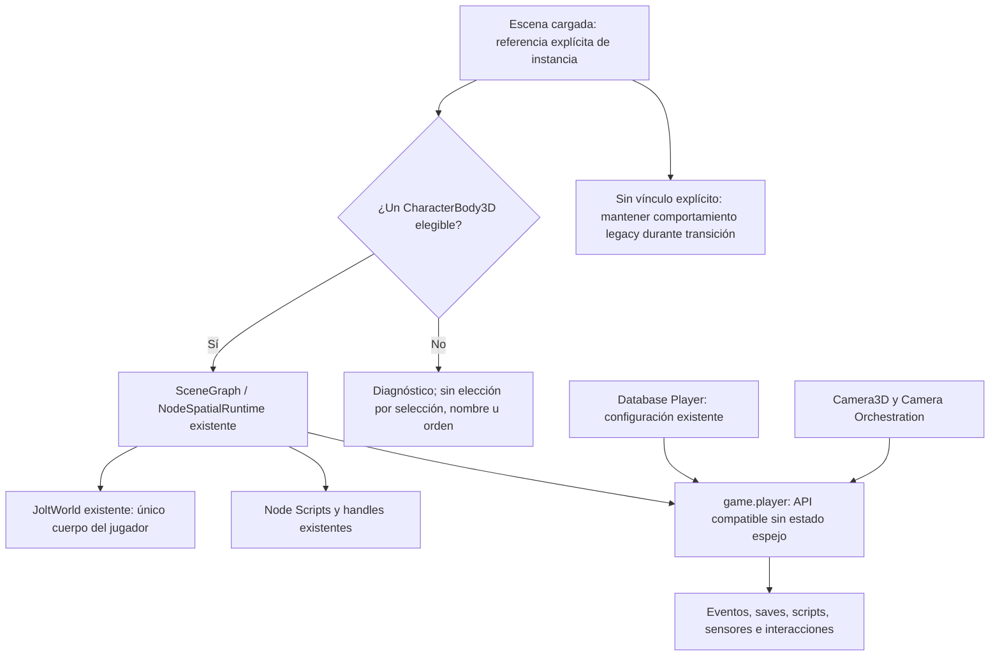

# LevelForge — S16 G002 · Contrato propuesto de identidad y API del jugador nativo

**Gate:** `LF-FPS-NATIVE-PLAYER-S16-G002-IDENTITY-API-CONTRACT`  
**Autorización literal:** recibida el 2026-11-11. **Tipo:** documental; no autoriza modificar runtime.  
**SOURCE_BASELINE:** `LF_FPS_NATIVE_PLAYER_S16_G001_AUDIT_CONTRACT_SOURCE_BASELINE.zip` (3.150 entradas, CRC correcto).  
**Autoridad:** S16-G001 aprobado por el usuario; decisión vinculante de construir el FPS con nodos y scripts normales; S15 Parent U-04/05/06, CAM-06/07/09; Timeline CA-005; contratos S07, Database, Prefabs y persistencia actuales.  
**Estado:** PROPUESTA TÉCNICA, pendiente de aprobación del usuario. **No es Contract Amendment ratificado ni implementación.**

## Objetivo y regla de propiedad

Un `CharacterBody3D` de la escena será el **único propietario de identidad espacial/física** del jugador nativo. `game.player` será una API pública compatible que lea/escriba los propietarios existentes; no un controlador adicional con copia de posición/velocidad/rotación. `game.viewModel`, Camera3D y Database conservan sus respectivos propietarios hasta que Gates de integración posteriores demuestren paridad. El motor no puede crear simultáneamente un FPS legacy y otro cuerpo nativo para el **mismo jugador**.

## Diagrama: identidad, fuentes y acceso

El diagrama describe una **propuesta para futuros Gates**, no interfaces nuevas ya presentes.

## Decisiones contractuales propuestas para aprobación

**ID16-01 — Identidad explícita y ámbito de escena.** La referencia a la instancia controlada pertenece a la **escena**, no al recurso `GameManager` compartido. Se recomienda persistir un ID de instancia de `CharacterBody3D` en un campo de escena que todavía **no existe** (nombre de campo por aprobar en Gate de implementación). No se seleccionará por Inspector, pista Timeline, nombre, `Spawn`, jerarquía o primer `CharacterBody3D` encontrado. La instancia nativa solo existe cuando se designa explícitamente. El nodo sigue siendo un tipo común, sin `PlayerRoot` especial.

**ID16-02 — Cero, uno o varios.** Cero vínculos explícitos: conservar exactamente el modo legacy o `Sin jugador` del proyecto durante la transición; **no activar** arbitrariamente otro personaje. Una referencia válida identifica uno entre cualquier cantidad de `CharacterBody3D`; los demás son personajes ordinarios. Referencia inexistente, duplicada, de otra escena, desactivada o de tipo incorrecto: diagnóstico bloqueante para la activación nativa; **no** elegir sustituto ni instanciar un FPS paralelo. Si existe un vínculo nativo en una escena configurada explícitamente como `Sin jugador`, la configuración es contradictoria y debe resolverse en autoría, no mediante prioridad implícita. La modalidad final y su interacción con `GameManager.player` se probarán antes de codificar.

**ID16-03 — Prefab y ciclo de vida.** El ID efectivo es el de la **instancia en la escena**, no el ID del recurso `.prefab`. `instantiatePrefab()` remapea IDs y `refreshInstance()` preserva el ID de la raíz pero regenera IDs de descendientes: si se permite asignar un cuerpo hijo, la actualización deberá reconciliar la referencia o invalidarla explícitamente. Preferir, sin imponer como nuevo tipo de nodo, un `CharacterBody3D` raíz cuando resulte apropiado. Al entrar en otra escena, validar y resolver allí una nueva referencia. Los handles obsoletos se invalidan mediante la sesión existente (`_referenceSession`). Nunca conservar un handle a través de cambios de escena como verdad persistente.

**ID16-04 — Único estado Jolt.** `NodeSpatialRuntime.characters` y su `characterState(id)` son la fuente de estado físico para el cuerpo seleccionado. `game.player.position`, velocidad y estado de suelo han de reflejar **ese mismo cuerpo**, no `FpsPlayer.pos`, `vy` y `grounded`. El ciclo de scripts nativos (`_physics_process`) y el orden de integración Jolt deben verificarse. `setVelocity(id, velocity)` existe internamente; la exposición al script de usuario y la locomoción completa **NO están demostradas**. No fabricar una segunda cápsula FPS para completar métodos ausentes.

**ID16-05 — Superficie pública y propiedad.** Conservar nombres, parámetros y semántica utilizada de `game.player` (posición, yaw, pitch, eye/forward/look, control/mode, configuración, grounded, movimiento, agua, actor y cámara); conservar `game.viewModel` para slots, attach/release/stash/throw hasta migración demostrada. Los getters/setters del futuro vínculo nativo deben consultar la fuente real en el momento de cada uso. Las opciones de movimiento provienen de Database como datos vigentes **sin duplicar registros**. API que aún no tenga equivalente nativo se declara BRECHA y bloquea el retiro de legacy, no se emula con otro controlador.

**ID16-06 — Cámara y control.** Camera Orchestration mantiene autoridad de la vista; `Camera3D` es un nodo ordinario (puede ser hijo del cuerpo) y nunca se elige por la selección editorial. `game.player.camera` conservará la semántica pública según el propietario de cámara existente; no asumir que cámara activa es siempre la hija del personaje. Input, bloqueo y mirada no fuerzan retorno implícito de cámara. Respetar CAM-06/07, Timeline CA-005, FilmMaker y la opción `Sin jugador`.

**ID16-07 — Guardado, escenas y ausencias.** `captureWorld/restoreWorld` guardan actualmente `pos`, `yaw`, `pitch`, `held`, `stashed` y `scene` según el controlador legacy. Antes de vincular nativamente, definir el mapeo de pose, orientación y manos al cuerpo/Camera3D reales. Resolver la identidad por escena al cargar, comprobar que existe el cuerpo y reponer estados físicos sin sobrescribir props autorales. No prometer compatibilidad retrospectiva no contratada, pero preservar proyectos y partidas actuales conforme al alcance vinculante.

**ID16-08 — Transición y retirada.** La transición es temporal y verificable: escenas sin vínculo siguen funcionando como antes; escenas nativas usan solo su nodo designado. No establecer ambos caminos como soluciones permanentes ni eliminar FpsPlayer, `play-player.js`, GameManager o APIs hasta paridad aprobada (Editor + Player independiente). El desmantelamiento posterior exige auditoría de consumidores y Gate propio.

## Matriz de escenarios de aceptación contractual

| Caso | Resultado contractual propuesto | Evidencia futura |
|---|---|---|
| Escena legacy, sin vínculo | FPS o `none` según configuración vigente | Regression legacy PlayMode |
| Escena con un cuerpo designado | Jugador = exactamente ese ID; sin cápsula FPS paralela | Jolt WASM + inspección runtime |
| Dos cuerpos, uno designado | Solo el explícito es `game.player`; otro permanece NPC | Node scripts + API + sensores |
| Dos cuerpos, ningún vínculo | No tomar el primero; transición legacy conservada | QA Editor/Player |
| Referencia inválida / desactivada | Diagnóstico; no fallback silencioso | Persistencia/reapertura |
| Prefab instanciado, aplicado o revertido | Vínculo rastreable o invalidado; jamás cambiar de personaje inadvertidamente | QA Prefab e IDs |
| Cambio de escena / partida guardada | Resolver nueva instancia; invalidar handles viejos | Save/load + transiciones |
| Selección y paneles cambian | No cambian quién controla ni la cámara efectiva | QA Editor/CA-005 |
| FilmMaker / `Sin jugador` | No fabricar player nativo ni llamar APIs no disponibles | Integración S15/FilmMaker |
| Edición de Database y `game.player` | Estado físico único; cambios transitorios no mutan recursos autorales | API contract/QA |

## Dependencias que bloquean el Gate técnico siguiente

1. **Aceptación de ID16-01..08** y del criterio de almacenamiento por escena. Si una fuente vinculante difiere, resolver mediante Contract Amendment específico, no por implementación oportunista.
2. **Auditoría de superficie de scripts:** `NodeSpatialRuntime.setVelocity/characterState` no están expuestos en el handle de `play-nodes.js`; además faltan garantías de salto, suelos y cambios de cápsula. Gate técnico debe verificar/autorizar cada operación y su prueba Jolt real.
3. **Reconciliar GameManager y serialización:** `normalizeGameManager` solo maneja `player/camera/profile`; `writePackage` copia `gameManagerId`/`transitions` por escena y debe incluir cualquier dato nuevo de identidad. Un recurso GameManager compartido no puede almacenar un ID scene-local sin reglas adicionales.
4. **Definir puente de API sin segundo estado:** catálogo de consumidores en el informe de QA; `game.player` actual viene de `FpsPlayer.api()` y `_host()`. Superficie final todavía **NO IMPLEMENTADA**.
5. **Riesgos de QA previos:** dos suites históricas G001 fallan (2 y 11 casos). Deben clasificarse contra interfaces reales; no corregir pruebas para simular paridad.

## Plan técnico actualizado — numeración no ejecutiva

La declaración autorizada de G002 es **IDENTITY-API-CONTRACT** y tiene prioridad sobre el G002 técnico propuesto en G001. Se actualiza la secuencia provisional sin perder el histórico documental:

| Gate | Alcance | Situación |
|---|---|---|
| S16-G001 | Auditoría/contrato inicial | APROBADO POR USUARIO; sin QA de producción |
| S16-G002-IDENTITY-API-CONTRACT | Identidad/API y resolución de prerrequisitos | DOCUMENTADO; pendiente aprobación del presente contrato |
| S16-G003 | CharacterBody3D/Jolt accesible a scripts de nodo | RECOMENDADO, NO AUTORIZADO |
| S16-G004 | Locomoción FPS e Input Map | RECOMENDADO, NO AUTORIZADO |
| S16-G005 | Camera3D y Camera Orchestration | RECOMENDADO, NO AUTORIZADO |
| S16-G006 | Interacciones/manos/agua/pasos; subdividir si exige varios Gate técnicos | RECOMENDADO, NO AUTORIZADO |
| S16-G007 | Prefab, Database, `game.player`, persistencia | RECOMENDADO, NO AUTORIZADO |
| S16-G008 | Retirada de FPS legacy tras paridad | RECOMENDADO, NO AUTORIZADO |
| S16-G009 | QA integrado Electron/Player/export y cierre | RECOMENDADO, NO AUTORIZADO |

**Nota:** la renumeración afecta solo propuestas **no autorizadas** de G001. No crea autorizaciones ni elimina la obligación contractual de exigir un Gate pequeño por unidad técnica. En el ledger se conserva la correspondencia histórica.

## Límites de G002 y próximo paso real

- **Realizado en este Gate:** auditoría documental, contrato propuesto, inventario de consumidores, QA documental y actualización de ledger.
- **No realizado:** implementación, nuevos campos/archivos de runtime, cambios de GameManager, script APIs, escena, tests funcionales o Player.
- **Siguiente acción:** aprobación del usuario del presente contrato; después, declaración y **autorización literal distinta** para el Gate técnico G003. No declarar G002 cerrado hasta esa aprobación.
