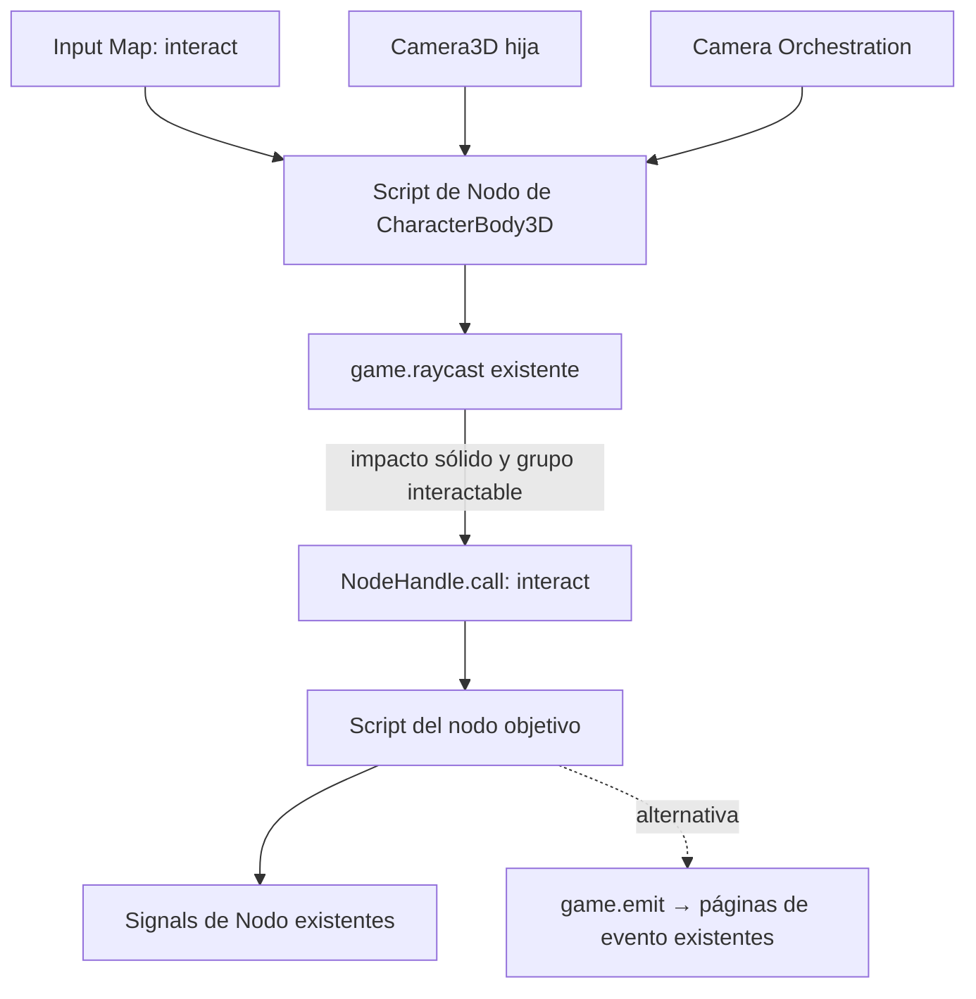

# LevelForge · S16-G006-G001 — Interacción nativa del personaje

**Gate autorizado:** `LF-FPS-NATIVE-PLAYER-S16-G006-G001-NATIVE-INTERACTION` (autorización literal 2026-11-12).  
**SOURCE_BASELINE de entrada:** `LF_FPS_NATIVE_PLAYER_S16_G005_CAMERA3D_ORCHESTRATION_G001_SOURCE_BASELINE.zip`.  
**Estado:** IMPLEMENTADO en fuentes; QA local Editor y NGM Runtime NO VERIFICADO.  
**Propósito:** interactuar desde una Camera3D ordinaria del personaje sin recurrir a `FpsPlayer`, `game.player.look()` ni gestores adicionales.

## Propietarios reales y cambio mínimo

- `src/engine/runtime/events/play-nodes.js`: `NodeHandle.worldForward` devuelve la dirección frontal mundial **-Z** del nodo, normalizada, incorporando las rotaciones de sus padres. Reutiliza el objeto de Three.js de la escena montada; no guarda transformaciones ni crea otro estado.
- `src/core/events/game-api.d.ts` y su copia idéntica en `vscode-extension/media/`: se declara `worldForward` para los Scripts de Nodo y referencias existentes.
- `scripts/fixtures/fps/s16-g006-native-interaction-node.js`: ejemplo independiente de Script de Nodo. Utiliza la acción `interact` del Input Map, la Camera3D hija `VistaFPS`, `game.camera.active` y un único `game.raycast` que ignora al propietario y alcanza **la primera superficie**. Solo invoca `target.call('interact', actorId)` si el nodo impactado pertenece al grupo `interactable`.
- `scripts/fixtures/fps/s16-g006-interactable-target-node.js`: receptor de demostración; registra el método público con `node.expose`, declara y emite la señal propia `interacted` con la API existente.
- `scripts/fixtures/fps/s16-g006-interactable-event-target-node.js`: **alternativa** de receptor que usa `game.emit('fps_interaction', { actorId, targetId })`; se vincula a páginas de evento con disparador «Al recibir señal». Es una alternativa al receptor de Signals de Nodo, no un segundo despacho automático.
- `scripts/fixtures/fps/s16-g006-native-interaction-scene.json`: escena/fixture de QA basada en G005, con objetivo `StaticBody3D`, collider y scripts. No se modifica ninguna escena o proyecto del usuario.

## Diagrama de responsabilidad

**Contrato operativo:** seleccionar nodos en el Editor no participa en el cálculo. No se filtra el rayo por tag/layer de modo que atraviese paredes no interactivas: primero se detecta la superficie más cercana, luego se valida el grupo del objetivo. Una pulsación de `interact` produce como máximo una llamada del controlador nativo por fotograma. El receptor es responsable de definir qué significa interactuar.

## Límites y compatibilidad

- Se mantienen intactos `FpsPlayer`, `game.player`, `play-events.js`, Jolt, Camera Orchestration, Database, Prefabs y Spawn. La retirada y consolidación de rutas heredadas son responsabilidad de G007/G008.
- La prueba Node usa dobles de `game.raycast` y de `NodeHandle.call`; no certifica el mapeo `mesh → node` en Jolt WASM, la presencia de colisiones en la escena del usuario, el acoplamiento con los eventos legacy, ni la paridad visual Editor/NGM Runtime.
- En escenas antiguas con Spawn/FpsPlayer podrían coexistir interacciones del controlador heredado y de un script nativo si el autor configura ambos sobre el mismo objeto. No se declara corregida esa coexistencia hasta la migración definitiva. Para QA G006 usar una escena nativa sin Spawn ni acciones duplicadas en páginas legacy.
- `worldForward` es una consulta general de pose mundial, no un controlador nuevo ni una característica exclusiva de FPS. La VSIX pasa a 0.1.8 para sincronizar su tipo; paquete offline CRC verificado, `@vscode/vsce` oficial e instalación local NO VERIFICADOS.
- La acción integrada `interact` conserva sus bindings existentes, que pueden coincidir con otras acciones (por ejemplo, Space y salto). No se cambian configuraciones globales.

## Criterios de aceptación pendientes

La regresión automatizada G006 y la anterior G003–G005 deben pasar. En el equipo del usuario deben comprobarse: rayos desde la cámara con yaw/pitch real, primeras superficies bloqueantes, invocación única por pulsación, señal/método/evento, cambio de autoridad cinematográfica, independencia de selección y ejecución en NGM Runtime. Sin esa evidencia, G006 no está CERRADO.
