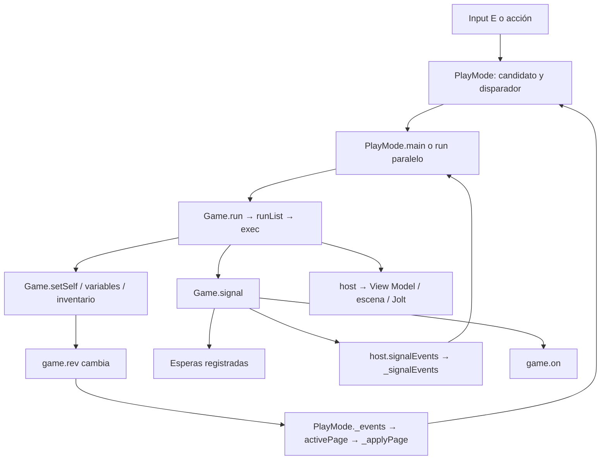
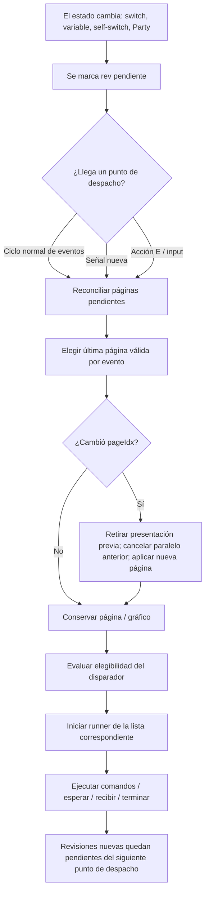
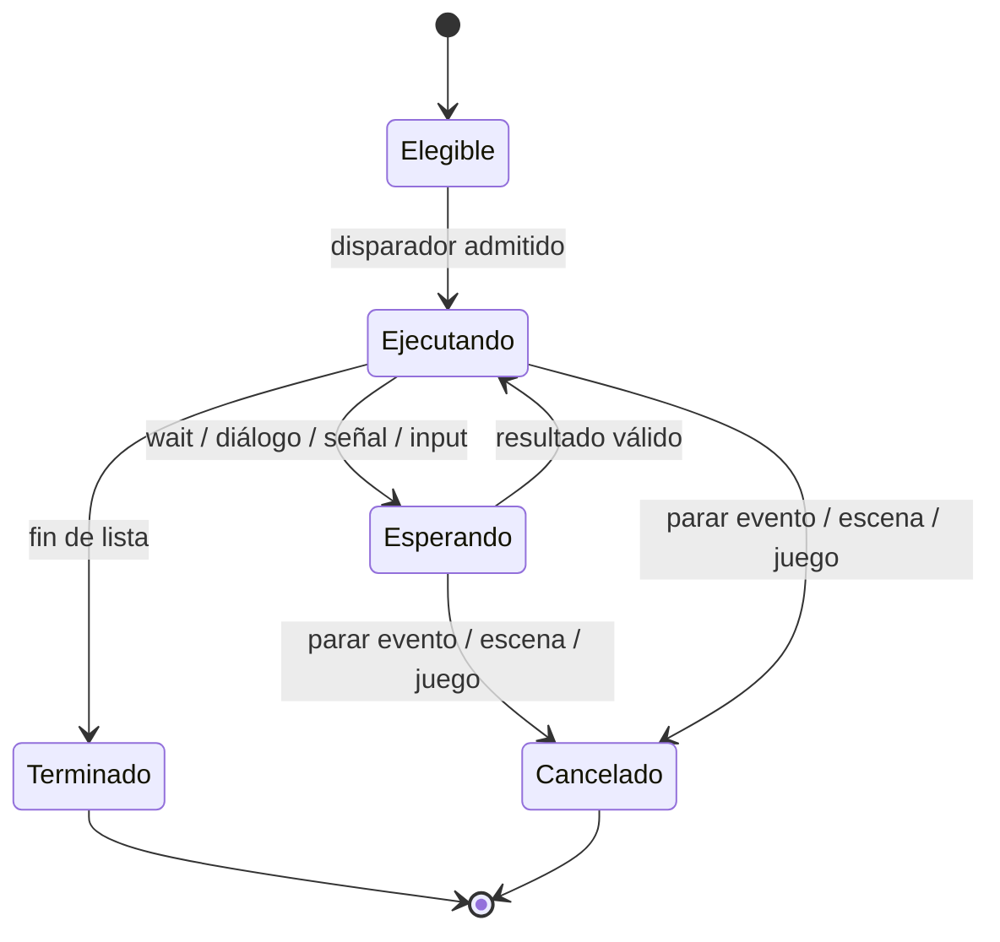

# LevelForge 0.26.13 — LF-EV-ORDER-G001
## Contrato de ejecución determinista de páginas de evento

**Estado:** FORMULADO / IMPLEMENTACIÓN NO AUTORIZADA.  
**Referencia:** `LevelForge_SIG_CORR_001_SOURCE_BASELINE.zip` + `LF_EVENTS_ARCH_AUDIT_G000.md`.  
**Principio rector:** mejorar el *Event Order Flow de las páginas*, sin cambiar el orden global de actualización del motor.  
**Restricciones:** EXTEND BEFORE DUPLICATE; SOLID sin capas innecesarias; no mezclar Match, F12, física, Database ni un EventBus nuevo.

### 1. Definiciones y propiedad de estado

| Concepto | Identidad / responsable actual | Regla contractual |
|---|---|---|
| Evento | `events[].id`, `props.pages`, `inst` | Conserva identidad aunque cambie de página, gráfico o View Model. |
| Página activa | `Game.activePage()` + `inst.pageIdx` (`play-events.js`) | La última página cuyas condiciones se cumplen. `-1` = ninguna. |
| Estado lógico | `Game.sw`, `vr`, `selfSw`, `Party`, `game.rev` | Modificar estado marca revisión; no cambia inventario por seleccionar página. |
| Gráfico, colisión, movimiento de página | `_applyPage()` | Corresponden a la página *confirmada*, sin recreaciones duplicadas. |
| Ejecución de comandos | `Game.run()`, `ctx`, `cancel()`, `done` | Una ejecución mantiene su lista de origen y contexto aun si cambia el gráfico. |
| Ejecución principal | `PlayMode.main` | Solo un runner principal; define `during` y el bloqueo mientras siga activo. |
| Paralelo de página | `inst.par` | Se cancela/recrea al cambiar la página. |
| Receptor de señal | `inst.runs` y `Game.signal()` | No se superpone la misma página; sin historial retroactivo de señales. |
| Manipulación | `inst.held`, `inst.stashed`, View Model | Independiente del número de página, y también del inventario. |

### 2. Comunicación actual (fuente auditada)



**Deuda confirmada:** `Game.signal()` llama a `host.signalEvents` de inmediato, pero la actualización de página depende de que `_events()` observe `game.rev`. También `this.main`, `e.runs` y `e.par` siguen políticas distintas, que hoy no están formalizadas en un solo contrato.

### 3. Order Flow contractual de PÁGINAS (propuesta)

Este flujo funciona **dentro** del ciclo existente. No cambia `game.update`, física fija, jugador, `game.lateUpdate`, ni el orden de los fotogramas.



**Reconciliación:** responsabilidad existente de `PlayMode`, ubicada en los métodos de eventos. Una operación idempotente (por revisión) deberá poder invocarse antes de despachar señales o un `E`, además de en `_events()`. No proponer un segundo scheduler ni hacer que `Game` importe `PlayMode`, Three o Jolt.

**Regla temporal:** cuando un comando cambia A y a continuación emite una señal *en la misma lista*, los receptores deben evaluarse sobre la página que corresponde a A=ON. No se usan `setTimeout`, `await wait(0)` ni demoras artificiales para conseguirlo.

**Reentrancia:** mientras se reconcilia no se realizará una reconciliación recursiva sin límites. Un cambio de revisión surgido durante la aplicación se marcará pendiente y se resolverá de forma acotada antes del siguiente despacho; si hay reconfiguración circular se informará como error, no se bloqueará el frame.

### 4. Ciclo de vida: los tres tipos principales de runner



| Tipo de ejecución | Al cambiar la página | Bloquea al jugador | Solapamiento |
|---|---|---|---|
| Principal: `action`, `touch`, `look`, `auto`, `input` | **Continúa su lista de origen** hasta terminar o cancelación explícita. No sustituir su lista a mitad de una espera. | Solo según `during` del runner que inició. | Un `main` a la vez. |
| Paralelo: `parallel` | **Cancela el paralelo de la página anterior**. Inicia el de la nueva página si corresponde. | No. | Uno por evento y página activa. |
| «Al recibir señal» | **Continúa la rama/lista ya iniciada** incluso si ella misma cambia el self-switch. El gráfico puede cambiar independientemente. | No. | Una ejecución por página; repetición mientras está activa: ignorar, como el contrato actual. |
| Ejecución explícita `event.run` | Conserva la página elegida y su lista de origen hasta terminar o cancelación explícita. | No automáticamente. | Reutiliza la promesa si ya corre esa misma página. |

**Motivo para no cancelar inmediatamente una lista por cambio de página:** «A = OFF; Mostrar texto» es un caso válido dentro de la página receptora de señal. Cancelar el runner apenas cambia A impediría ejecutar «Mostrar texto». Esta regla también conserva el comportamiento actual del runner principal: no se debe introducir una cancelación implícita nueva.

**Bloqueo:** `during=locked` + espera indefinida bloquea por diseño mientras el runner principal siga vivo. Se mantiene la opción `free` para eventos que deban esperar sin bloquear. La futura UX podrá advertir sobre combinaciones peligrosas, pero **este Gate no cambiará automáticamente el modo de control**. Al terminar/cancelar, `main` debe liberarse y recuperar el control según la configuración restante.

### 5. Tabla de elegibilidad por disparador

| Disparador de la página activa | En mundo | `held` | `stashed` | Regla |
|---|---|---|---|---|
| `action`, `touch`, `look` | Sí | No | No | Requieren candidato espacial. `E` no reactiva automáticamente un evento sostenido. |
| `input` | Sí | **Por definir en contrato posterior de Input Map** | No | Conservar por ahora la restricción actual; no mezclar esta revisión con comandos de manos. |
| `auto` / `parallel` | Sí | Según comportamiento actual | No | Afectados por la página activa; paralelos tienen cancelación propia. |
| `signal` | Sí | **Sí** | **No por defecto** | Señal lógica independiente de la cercanía; no reactivar objetos guardados/consumidos sin contrato adicional. |

Ninguna señal debe modificar automáticamente inventario, física ni el estado `held` de un evento. `object.dropped` y `object.thrown` son distintas. El receptor solo se activa si tiene `trigger='signal'` y nombre coincidente; insertar `waitSignal` en una página con disparador `action` no la convierte en oyente permanente.

### 6. Prioridades y despacho

- **Orden general sin alteraciones:** `_events()` sigue después de actualización del jugador/animación y antes de `_inputTriggers()` y `game.lateUpdate()`.
- **Dentro del ciclo normal:** reconciliar páginas; revisar `auto`; revisar `parallel`; comunes; candidatos espaciales; `_inputTriggers()` cuando le toque dentro de la simulación.
- **Antes de `E` desde callback de teclado:** reconciliar y volver a validar la página y elegibilidad del candidato. No iniciar un comando con un candidato obsoleto tras un self-switch.
- **En señal:** mantener orden de `Game.signal`: esperas ya inscritas → páginas receptoras → `game.on`; asegurar reconciliación de páginas **antes** de comprobar receptores. Un `await game.signal()` no significa esperar a que terminen todos los runners receptores.
- **No replay:** la señal emitida antes de que exista una espera no se almacena. Esto es distinto del problema de selección de página, que sí hay que resolver con reconciliación determinista.

### 7. Ejemplo obligatorio: botella en mano y self-switch

```mermaid
sequenceDiagram
  participant U as Jugador
  participant P1 as Página 1 / runner principal
  participant ST as Game: selfSw A y rev
  participant PAGE as PlayMode: páginas
  participant VM as View Model
  participant SIG as Game.signal
  participant P2 as Página 2 / runner de señal
  U->>P1: E (si está en mundo y es candidata)
  P1->>VM: adjuntar evento
  P1->>ST: A = ON
  ST-->>PAGE: revisión pendiente
  PAGE->>PAGE: confirmar página 2 (gráfico nuevo)
  Note over VM,PAGE: El evento sigue en mano; inventario intacto
  U->>VM: soltar el objeto
  VM->>SIG: object.dropped + payload
  SIG->>PAGE: reconciliar antes del receptor
  PAGE->>P2: ejecutar «Al recibir señal» (si coincide)
  P2->>ST: A = OFF
  P2->>P2: continuar comandos restantes
  ST-->>PAGE: revisión pendiente
  PAGE->>PAGE: confirmar página 1 en siguiente punto válido
  Note over P1,P2: Ninguna transición sustituye comandos de runner en progreso
```

**Distinción:** si P2 está configurada como «Botón de acción» y contiene «Esperar señal», no comienza a escuchar automáticamente al activarse. Para recibir sin E, P2 debe usar el disparador «Al recibir señal», con `object.dropped` para soltar o `object.thrown` para lanzar.

### 8. SOLID y rutas de modificación previstas (sin código todavía)

| Archivo existente | Responsabilidad permitida |
|---|---|
| `play-events.js` | Reconciliar páginas y conservar selección/ciclo de presentación. Separar la reconciliación del recorrido de disparadores (una función corta). |
| `play-signals.js` | Elegibilidad y despacho lógico de páginas de señal; sincronizar con reconciliación, sin tocar Game/Three/Jolt. |
| `play-controls.js` | Validación fresca antes de activar `E`; propiedad y liberación de `main` sin heurísticas de físicas. |
| `play-input.js` | Conservar Input Map/orden existente; solo reutilizar reconciliación donde sea indispensable. |
| `interpreter.js` | Administrar runner y cancelación, sin seleccionar páginas ni controlar físicas. Cambios únicamente si una prueba demuestra necesidad. |
| `play-host.js` | Puente de capacidades: no introducir dependencias de `Game` hacia `PlayMode`. |

**Sin crear:** EventBus paralelo, un motor de tareas nuevo, herencia de ejecutores, Promise scheduler independiente, global flags especiales por señal, una copia de `Game` por página o lógica de Jolt dentro del intérprete.

### 9. Matriz de aceptación — contrato mínimo

| ID | Escenario reproducible | Resultado esperado |
|---|---|---|
| EV-ORDER-01 | Página 1 activa A=OFF → ejecutar comando self-switch A=ON | Página 2 seleccionada en la próxima reconciliación, mismo ID de evento. |
| EV-ORDER-02 | A=ON y emitir `object.dropped` en la **misma ejecución** | Reacciona la página 2, no la anterior. Sin delays. |
| EV-ORDER-03 | A=ON, evento sostenido, P2 `trigger='signal'` | P2 recibe señal; no habilita E sobre el objeto sostenido. |
| EV-ORDER-04 | P2 `trigger='action'` con `waitSignal` pero sin segundo E | No inicia espera automáticamente; contrato explícito. |
| EV-ORDER-05 | P2 señal hace A=OFF y luego «Mostrar texto» | La lista en curso termina; no se cancela después del primer comando. |
| EV-ORDER-06 | P1 paralelo activo → A=ON activa P2 paralelo | P1 paralelo cancelado, P2 único, sin duplicados. |
| EV-ORDER-07 | P1 principal activa A y ejecuta otra orden | P1 runner continúa lista original y termina; no sustituye comandos. |
| EV-ORDER-08 | `main` locked esperando señal, cancelar evento o detener juego | Espera cancelada y control liberado, sin runner huérfano. |
| EV-ORDER-09 | Mismo caso con `during=free` | Movimiento permitido durante espera, sin activar otro `main`. |
| EV-ORDER-10 | `E` con candidato previo a cambio de A | Se revalida la página; no arranca lista obsoleta. |
| EV-ORDER-11 | Cambiar P1 botella → P2 llave → P3 sin gráfico, sostenido | View Model e identidad de evento intactos; inventario no cambia por página. |
| EV-ORDER-12 | Señales duplicadas cuando receptor ejecuta | No superponer receptor activo; sin colas ocultas. |
| EV-ORDER-13 | Dos eventos, misma señal, `held/stashed/off` | Comportamiento de elegibilidad previsto, sin filtros espaciales accidentales en `held`. |
| EV-ORDER-14 | Regresión completa y comprobación en Player exportado | Misma selección, runners y señales; no regresión de los 168 tests previos. |

Las pruebas deben usar `Game` real más `PlayMode` con host/controladores sustitutos para comprobar las transiciones, **no limitarse a buscar textos en los archivos**. Las pruebas reales de editor y Player siguen siendo necesarias.

### 10. Fuera de alcance de este primer Gate

- Comando `Match`.
- DevTools/F12.
- Cambiar las reglas de físicas de Database o la balística.
- Inventario automático al cambiar página.
- Rehacer el sistema de eventos desde cero.
- Cambiar el Event Order Flow general del motor.
- Cambiar semánticas de señales pasadas, o agregar almacenamiento/replay de señales.

### 11. Cierre y autorización

**Gate propuesto:** `LF-EV-ORDER-G001` — «Reconciliación y ciclo de vida de páginas de evento».  
**Entrega de implementación:** un Change ZIP de código, guía de QA y ledger, más Source Baseline completo.  
**QA obligatorio:** 14 escenarios nuevos, regresión previa, build de editor y Player, prueba con self-switch + objeto sostenido + señales.  
**Estado actual:** contrato únicamente; **no se ha implementado**. Requiere autorización del usuario para modificar código.
