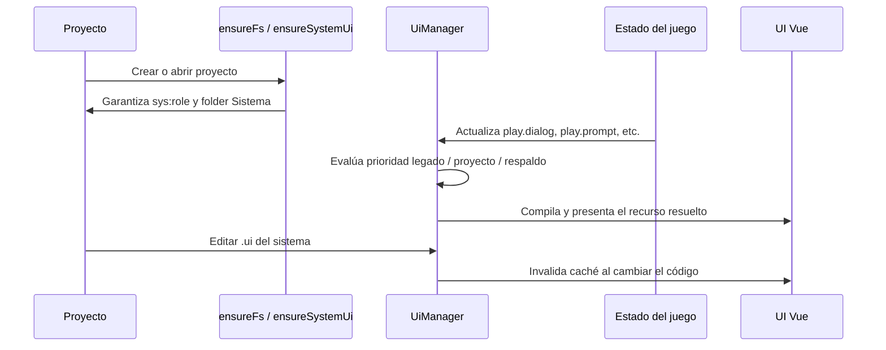

# LF-UI-SYSTEM-ASSETS-G001 — Contrato de implementación

## Modelo único

El origen integrado de las nueve interfaces permanece en `src/engine/runtime/ui/system.js`. Cada proyecto posee un documento persistido por uso en `Assets/UI/Sistema`, con identificador estable `sys:<rol>` y atributo `systemRole`. No existen dos motores de UI ni dos catálogos de roles.

`ensureSystemUi(meta)` garantiza la presencia de los recursos al normalizar un proyecto: no sobreescribe el `code` personalizado. Los nuevos documentos se escriben dentro del `.lfproj` como `Assets/UI/Sistema/<archivo>.ui`. En un proyecto viejo sin esos archivos, la normalización agrega los nuevos sin alterar un Canvas con rol guardado en la escena.

La prioridad en tiempo de juego sigue siendo: Canvas heredado con uso explícito → asignación legacy por rol → UI del proyecto `sys:<rol>` → respaldo virtual del motor. Una pantalla nativa no depende de añadir Canvas. El gestor existente `UiManager` conserva la resolución de prioridad, capas, modo modal y renderizado de Vue.

## Protección

La protección se aplica por identidad de recurso (`sys:<rol>`), no por un icono de candado. Las operaciones de `ui-assets.js` y `filesystem.js` rechazan borrado, renombrado, duplicación, movimiento y rutas reservadas, incluida la eliminación o traslado de carpetas antecesoras. El UI Editor sí permite modificar el contenido del recurso y ofrece restauración con confirmación.

Los nuevos Canvas solo pueden crearse como «interfaz propia». Los Canvas antiguos con roles guardados no se borran ni migran de forma destructiva.

## Orden de ejecución

**No incluye:** editor de fuentes, F12, Match ni protección externa de la carpeta del proyecto.
