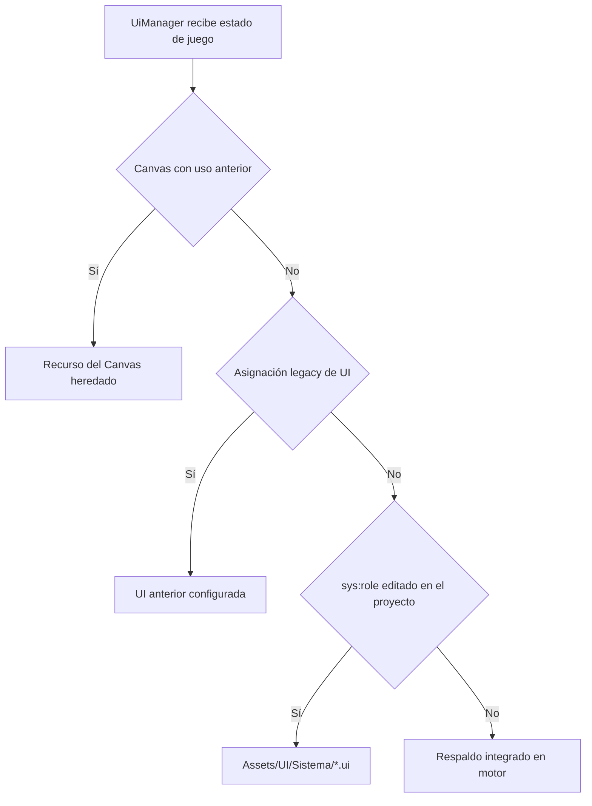

# LF-UI-SYSTEM-ASSETS-G001 — QA de interfaces nativas

**Estado:** IMPLEMENTADO · PENDIENTE QA VISUAL / COMPILACIÓN / PLAYER. **Fecha:** 2026-10-24.

## Contrato

- Los recursos del motor viven en `Assets/UI/Sistema`, identificados por `sys:dialog`, `sys:choices`, `sys:prompt`, `sys:held_actions`, `sys:fade`, `sys:letterbox`, `sys:caption`, `sys:levelname` y `sys:skip`.
- Las interfaces aparecen automáticamente por el estado del juego: no es necesario crear un nodo Canvas para diálogos, opciones, fundido, subtítulos, etc.
- Puedes editar un `.ui` en esa carpeta desde el UI Editor; los cambios se guardan con el proyecto y tienen prioridad frente al respaldo integrado del motor.
- Los documentos del sistema **no se pueden eliminar, mover, renombrar ni duplicar desde LevelForge**. Las operaciones sobre la carpeta reservada y el padre `Assets/UI` que afectarían a esos documentos se rechazan.
- `Restaurar original` solicita confirmación y repone el contenido de fábrica; no altera las interfaces ajenas al sistema.
- Un Canvas antiguo con «Uso» conserva su ejecución y prioridad sobre la versión nativa. Los nuevos Canvas solo se ofrecen como «interfaz propia».
- Si un documento integrado falta en una exportación antigua, el motor mantiene el respaldo `sys:*` para evitar pantallas vacías. La importación de `.lfproj` antiguo no debe reportar esos documentos como perdidos.

## Arquitectura / resolución

`ensureFs()` crea los documentos nativos al abrir proyectos antiguos y al instalar proyectos nuevos; no duplica los existentes ni borra código personalizado. `UiManager` permanece como único controlador de renderizado. Las operaciones del explorador pasan por el módulo existente de filesystem.

## QA automatizada ejecutada

Comando: `node --test scripts/test-db-contract.mjs` — **356 PASS, 0 FAIL, 0 TODO**. Incluye 344 anteriores y 12 SYSUI nuevas. `node --check` en fuentes JS editadas: sin fallos. Las pruebas nuevas comprueban esquema, identidad, creación idempotente, preservación de código, compatibilidad, contratos de selección y prohibiciones estructurales; no ejecutan Vue visualmente ni el filesystem del navegador.

Compilación: `npm run build` — **no verificada**: entorno sin dependencias instaladas (`vite: not found`). No afirmar que la integración gráfica esté probada.

## Escenarios para QA local

| ID | Prueba | Resultado requerido |
|---|---|---|
| SYS-LOCAL-01 | Abrir proyecto anterior sin carpeta Sistema | La carpeta y los nueve `.ui` aparecen sin perder Canvas propios |
| SYS-LOCAL-02 | Crear proyecto nuevo | Sistema aparece automáticamente |
| SYS-LOCAL-03 | Shift+A → Interfaz | Solo Canvas propio y elementos de autoría, no presets del motor |
| SYS-LOCAL-04 | Abrir `Assets/UI/Sistema/dialogo.ui` | UI Editor muestra contenido nativo, editable |
| SYS-LOCAL-05 | Personalizar diálogo y mostrar texto | El juego usa el diseño modificado sin añadir Canvas |
| SYS-LOCAL-06 | Personalizar acciones de mano | Al recoger un objeto usa la UI personalizada |
| SYS-LOCAL-07 | Cerrar y abrir LevelForge | Se conservan las modificaciones |
| SYS-LOCAL-08 | Exportar `.lfproj` y volverlo a importar | Los recursos `.ui` personalizados se conservan en el ZIP |
| SYS-LOCAL-09 | Borrar un `.ui` del motor desde el explorador | Operación rechazada sin pérdida de archivos |
| SYS-LOCAL-10 | Renombrar, duplicar, mover y arrastrar ese `.ui` | Operaciones rechazadas |
| SYS-LOCAL-11 | Renombrar, mover y borrar `Assets/UI/Sistema` o `Assets/UI` | Rechazado; el proyecto se mantiene íntegro |
| SYS-LOCAL-12 | Seleccionar «Restaurar original» y confirmar | Recupera el contenido integrado |
| SYS-LOCAL-13 | Usar Canvas de sistema heredado y personalizado | Sigue prevaleciendo el Canvas antiguo |
| SYS-LOCAL-14 | Usar Canvas propio nuevo | Sigue funcionando independiente de nativos |
| SYS-LOCAL-15 | Abrir `.lfproj` antiguo sin archivos nativos | No se notifica pérdida falsa de los nueve `.ui` |
| SYS-LOCAL-16 | Player exportado/AppImage | Mismas interfaces nativas editadas y sin duplicaciones |

## Límites

- La protección contra borrado actúa dentro del editor y sobre su formato de proyecto. No bloquea a un usuario que manipule el archivo de proyecto fuera de LevelForge con herramientas del sistema operativo.
- Las fuentes importadas y su selección por elemento del UI Editor pertenecen a `LF-UI-FONT-G001`, fuera del alcance de este Gate.
- `Match`, F12 y seguridad de la raíz de proyecto permanecen en sus Gates separados.
