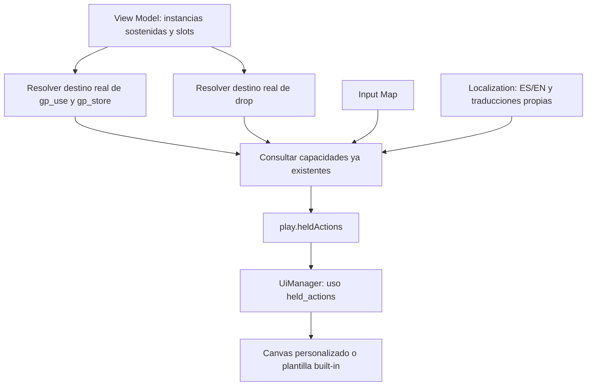

# LF-UX-HELD-G001_CORR-001 — HUD compacto y acciones por mano

**Fecha:** 2026-10-24  
**Baseline de partida:** `LevelForge_UX_HELD_G001_SOURCE_BASELINE.zip`  
**Estado:** IMPLEMENTADO · PENDIENTE DE QA VISUAL EN EDITOR/PLAYER

## Qué cambia

La interfaz del sistema `held_actions` se mantiene dentro de UiManager/Canvas. Ahora aparece **abajo a la izquierda**, con letra pequeña y **dos columnas comunes** para todas las filas: tecla a la izquierda, descripción a la derecha. Las filas no se justifican individualmente por su longitud; «Mantener para lanzar» no desplaza la tecla hacia un lado. No hay un panel opaco grande ni nuevas capturas de entrada.

Se conserva el formato `[tecla] Acción`, la localización y el Input Map existente. Una interfaz `.ui` del creador con `Uso: Acciones del objeto en mano` sigue reemplazando al built-in.

## Contexto real de manos

El View Model dispone de slots independientes `left`, `right` y otros configurables. Sin embargo, **el Input Map de Gameplay Object no ofrece aún una selección genérica de qué mano usar**:

- `gp_use` y `gp_store` operan sobre el **primer Gameplay Object sostenido** que selecciona `_gpActionInput()`.
- `drop` prioriza **el último objeto de la mano derecha** y, si está vacía, el último objeto sostenido (`_dropHeld()`). Pulsación corta y mantenida comparten esa entrada.

La nueva presentación respeta exactamente esa selección. Con **un solo objeto**, no aparece «Der.» ni «Izq.» porque no aportan información. Con **dos objetos distintos en slots diferentes**, se indica la mano del destino real de cada acción (`Usar · Izq.`, `Soltar · Der.`, etc.). No se muestran acciones no disponibles para otra mano como si pudieran ejecutarse.

Un solo objeto no produce filas dobles, aunque el creador configure varios anclajes o un slot especial. **No se han añadido mecánicas de doble empuñadura ni nuevas asignaciones por mano.** Para permitir acciones independientes seleccionables sobre ambas manos habrá que definir posteriormente otro contrato de entrada; esta UI no lo simula.

## Comunicación



La UI no ejecuta las acciones, no cambia Database, inventario, físicas, páginas de Event ni Input Map. `ui.held.hand.left` y `ui.held.hand.right` se añaden como textos built-in traducibles. La etiqueta de mano solo se utiliza cuando hay varios objetos de slots distintos.

## QA automatizada

```bash
node --test scripts/test-db-contract.mjs
```

**Resultado obtenido aquí:** **307 PASS / 0 FAIL / 0 TODO**; 289 pruebas anteriores + 18 casos HELD-C. Sintaxis JS comprobada con `node --check`.

Los tests comprueban contratos de estilo CSS, disponibilidad contextual, destino verdadero según el código de entrada, localización, reasignación de teclas y prioridad de Canvas. **No certifican la compilación Vue ni el resultado visual real.**

`npm run build` devolvió `sh: 1: vite: not found` por falta de dependencias en el entorno de entrega. Chromium tampoco completó la captura de la previsualización estática; no se presenta una prueba visual simulada como si fuese el editor.

## QA local requerida antes de aprobar

- [ ] **HELD-C01** · Con objeto sostenido, la UI aparece abajo a la **izquierda**, nunca a la derecha.
- [ ] **HELD-C02** · Todas las teclas comienzan en la misma columna; todas las acciones comienzan en otra fija.
- [ ] **HELD-C03** · «Mantener para lanzar» no desplaza su tecla: sin el efecto «serpiente» de la captura original.
- [ ] **HELD-C04** · Fuente, margen y separación no obstaculizan la vista del juego.
- [ ] **HELD-C05** · Distintas resoluciones y formato 16:9 / 4:3 / móvil, sin salir de pantalla.
- [ ] **HELD-C06** · Mano vacía: ninguna fila.
- [ ] **HELD-C07** · Un objeto en la derecha: solo acciones válidas y sin sufijo redundante.
- [ ] **HELD-C08** · Un objeto en la izquierda: mismo comportamiento.
- [ ] **HELD-C09** · Dos objetos: comprobar `Usar/Guardar` del primer GP y `Soltar/Lanzar` de la mano derecha.
- [ ] **HELD-C10** · Un objeto en la izquierda y otro heredado en la derecha: no anunciar operaciones no ejecutables.
- [ ] **HELD-C11** · Objeto de dos manos, **si el controlador lo admite**, sin filas duplicadas.
- [ ] **HELD-C12** · Un objeto que no puede utilizarse: ocultar Usar.
- [ ] **HELD-C13** · Inventario lleno / almacenar inválido: ocultar Guardar.
- [ ] **HELD-C14** · Durante bloqueo de Gameplay: no anunciar Usar/Guardar aunque el objeto permanezca en mano.
- [ ] **HELD-C15** · Reasignar teclas en Input Map, incluido mando: la columna de teclas se actualiza.
- [ ] **HELD-C16** · Idioma español, inglés y traducción personalizada de «Der.» / «Izq.».
- [ ] **HELD-C17** · Canvas `.ui` con uso `held_actions`: reemplaza la plantilla, no aparecen ambas.
- [ ] **HELD-C18** · Soltar/lanzar/guardar/consumir cambia la lista sin acciones obsoletas.
- [ ] **HELD-C19** · Repetir dentro del Player del editor, verificando que el HUD no capture entrada.
- [ ] **HELD-C20** · Repetir en juego exportado; comparar tipografía, posición y comportamiento.

## Limitaciones explícitas

- Si el creador asigna **la misma tecla a dos acciones independientes** (`gp_use` y `gp_store`), el controlador actual puede recibir ambas. Este Gate **no cambia** la resolución de conflictos de Input Map. Las etiquetas de soltar/lanzar sí pueden compartir tecla porque usan los gestos corto/largo existentes.
- El View Model soporta varios slots, pero **no existe aún una acción nativa para elegir manualmente qué mano usar o soltar**. No inventamos esa funcionalidad desde la UI.
- Para correr el build, usa las dependencias normales del proyecto (`npm ci` si faltan) y `npm run build` en tu equipo; las dependencias no forman parte de los ZIP de entrega.

**Criterio de cierre:** evidencia visual de las dos columnas sin desalineación, posición abajo a la izquierda, acciones en una y dos manos compatibles, y ejecución en Player. Mientras falte, el Gate queda implementado pero pendiente de QA local.
