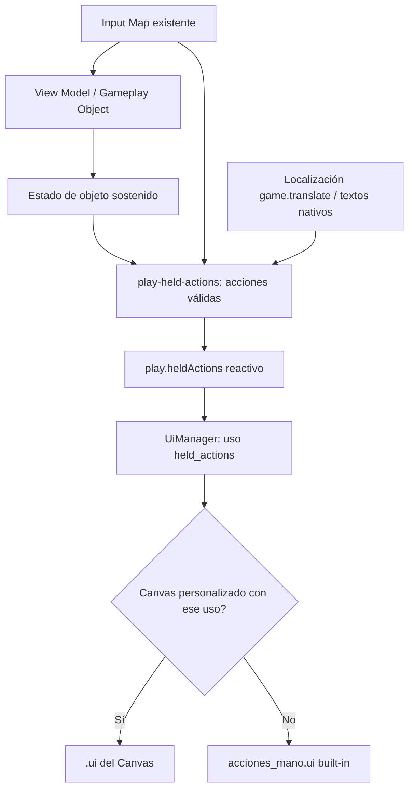

# LF-UX-HELD-G001 — Built-in Held Object Actions UI

**Fecha:** 2026-10-24  
**Base:** `LevelForge_UX_INTERACT_CORR_001_SOURCE_BASELINE.zip`  
**Estado:** IMPLEMENTADO · PENDIENTE QA VISUAL LOCAL

## Propósito

Mostrar, abajo a la derecha, únicamente `[tecla] Acción` mientras hay un objeto en la mano. La pantalla no ejecuta acciones: consulta el estado confirmado del View Model, la capacidad del Gameplay Object, el Input Map y el idioma. «Soltar» y «Mantener para lanzar» comparten la acción `drop`. No se cambia el orden de ejecución de los eventos ni el sistema físico.

## Integración con arquitectura existente



- `ui/system.js`: declara `held_actions`, capa 22, documento virtual `sys:held_actions`, visibilidad condicionada al objeto sostenido y al estado del juego.
- `ui/manager.js`: utiliza la selección Canvas → interfaz predeterminada **ya existente**, sin cambiar el algoritmo.
- `events/play-held-actions.js`: calcula filas para el objeto sostenido y actualiza el estado reactivo sin sobrescribirlo si no hay diferencias.
- `i18n/system-texts.js`: etiquetas nativas ES/EN con respaldo; una clave localizada del proyecto tiene prioridad.
- `input/inputmap.js`: permite conocer el último dispositivo con una pulsación efectiva para presentar sus bindings. No crea acciones adicionales.
- `play-controls.js`: sincroniza acciones después de actualizar la mano y la física en cada fotograma.
- La pantalla built-in es informativa, no recibe clics ni sustituye el Input Map.

## Acciones

| Operación | Acción Input Map | Texto localizado | Requisitos |
|---|---|---|---|
| Usar | `gp_use` | `ui.held.use` | Gameplay Object válido, utilizable y preparado; inventario/arma equipada según reglas existentes |
| Guardar | `gp_store` | `ui.held.store` | Gameplay Object y capacidad válida |
| Soltar | `drop` | `ui.held.drop` | Objeto en la mano, `dropEnabled !== false` |
| Mantener para lanzar | `drop` | `ui.held.throw` | Comparte la pulsación larga definida en el controlador |

Los objetos sostenidos por comandos heredados del View Model no anuncian Usar/Guardar si esas operaciones no están integradas para ellos. El idioma base es español cuando no hay traducción disponible; inglés nativo está incluido. No se crean entradas en la tabla de localización del usuario automáticamente.

## QA automatizada

```bash
node --test scripts/test-db-contract.mjs
```

Resultado verificado en el entorno aislado: **289 PASS / 0 FAIL / 0 TODO** (263 previas + 26 HELD). Se verificó sintaxis del código Javascript modificado.

**Compilación:** `npm run build` → `sh: 1: vite: not found` (dependencias no instaladas aquí). **NO** se ejecutó Electron/Player/Jolt ni se verificó la representación visual. Estos escenarios siguen pendientes en el equipo del usuario.

## QA funcional pendiente

- [ ] HELD-01 · Manos vacías: no se ve ninguna fila.
- [ ] HELD-02 · Recoger Gameplay Object: aparece la lista abajo a la derecha.
- [ ] HELD-03 · Sostener un arma configurada: aparecen únicamente sus operaciones compatibles.
- [ ] HELD-04 · Un objeto sin posibilidad de uso no muestra `Usar`.
- [ ] HELD-05 · Guardar el objeto: desaparece la UI si la mano queda vacía.
- [ ] HELD-06 · Soltar con pulsación corta: desaparece la UI y funciona la física existente.
- [ ] HELD-07 · Lanzar con pulsación mantenida: desaparece la UI; ambas indicaciones tienen la misma entrada.
- [ ] HELD-08 · Consumir la última unidad: se oculta al dejar de sostenerla.
- [ ] HELD-09 · Reasignar `gp_use` y `drop`: cambian las teclas presentadas.
- [ ] HELD-10 · Deshabilitar o borrar bindings: desaparecen las acciones correspondientes.
- [ ] HELD-11 · Cambiar idioma ES/EN con `game.lang`: cambia la acción sin alterar la tecla.
- [ ] HELD-12 · Clave ausente: se usa el texto built-in sin mostrar el nombre de la clave.
- [ ] HELD-13 · Canvas con `Uso: Acciones del objeto en mano` y `.ui` propio: solo se muestra el Canvas propio.
- [ ] HELD-14 · Canvas con ese Uso, pero oculto: no se muestra el built-in de respaldo (misma regla existente de Canvas).
- [ ] HELD-15 · Diferentes resoluciones y relaciones de aspecto: sigue anclada abajo a la derecha.
- [ ] HELD-16 · Usar mando y luego teclado: representación del control correspondiente.
- [ ] HELD-17 · Al abrir diálogo/modal o perder foco: no se superpone con las otras pantallas.
- [ ] HELD-18 · Objetos heredados sostenidos: no anunciar operaciones inexistentes.
- [ ] HELD-19 · Ejecutar en modo Jugar de Electron con UI real.
- [ ] HELD-20 · Repetir en Player exportado con bindings/localización persistidos.

## Deudas pendientes de cierre

- **Visual/editor/Player/exportado:** la suite Node no simula montaje real del componente Vue.
- **Build local:** falta `node_modules` y Vite en este entorno aislado.
- La interfaz no incorpora nuevos controles ni un editor dedicado para filas; el usuario la puede sustituir mediante un Canvas `.ui` con el uso `Acciones del objeto en mano`.
- No se toca el indicador espacial, la física de Gameplay Object ni la protección de carpetas del proyecto.

**Criterio de aprobación:** revisión de `npm run build`, ejecución visual, comportamiento de los cuatro tipos de operación, rebind, idioma y Canvas personalizado, sin regresiones.
