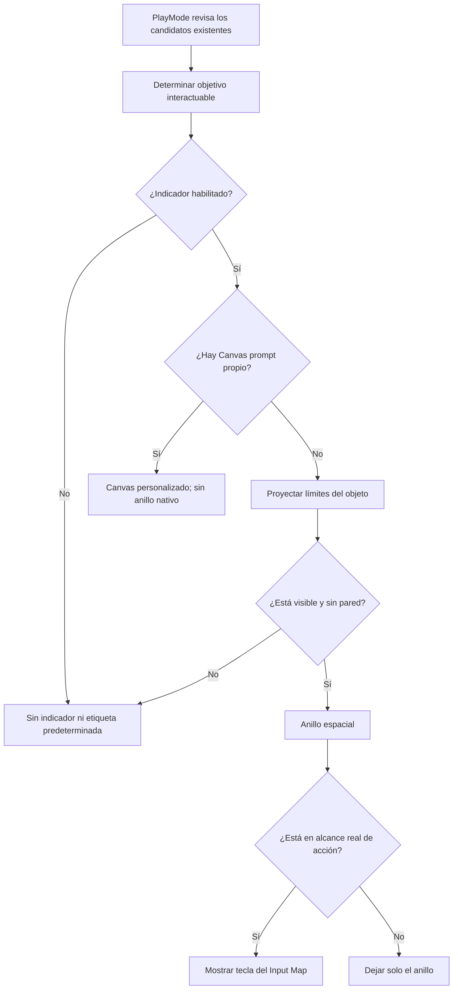

# LF-UX-INTERACT-G001 — Indicador espacial para Event y Gameplay Object

**Estado:** implementado · pendiente QA visual local. **Baseline:** `LevelForge_GP_OBJ_PHY_G001_SOURCE_BASELINE.zip`.
**Referencia visual:** `FrostEngine_v1(1).unitypackage` → `FrostInteractionIndicatorComponent.cs`.

## Arquitectura

- La selección de la acción `interact` sigue a cargo de `play-events.js` y `play-gameplay-objects.js`. Se conserva `PlayMode._press()` y su Input Map, sin otro listener ni detector de interacción.
- `play-interaction-indicator.js` consume la selección existente. Proyecta el centro visual del objeto con Three.js, consulta distancias y comprueba obstáculos. Un margen visual adicional de 1,5 m permite ver solo el anillo antes de que aparezca la tecla. **No amplía el alcance real de `E`.**
- `UiRoot.vue` dibuja un anillo pequeño de 26 px con la tecla asignada, utilizando `play.interactionIndicator` como estado de presentación; no intercepta eventos del ratón.
- `EventEditor.vue` controla `page.showIndicator` por página. Valor predeterminado/legacy: **false**. Solo páginas con disparador `action` muestran el indicador. Al cambiar de página se aplica la configuración activa.
- `Inspector.vue` controla `obj.props.showIndicator` de Gameplay Object. Valor predeterminado/legacy: **true**.
- Si el proyecto usa un Canvas `prompt` con UI explícitamente asignada o un rol `prompt` heredado, esa UI tiene prioridad. Así el indicador nativo no se duplica con el diseño personalizado. Con eventos desactivados tampoco aparece la etiqueta negra heredada.
- La interfaz contextual futura (Usar/Guardar/Soltar/Lanzar), F12, Match, protección de carpeta, físicas y Event Order Flow general quedan fuera del Gate.

## Orden de presentación



## Regresión automatizada

Comando: `node --test scripts/test-db-contract.mjs`

**Resultado comprobado en este entorno:** **243 PASS, 0 FAIL, 0 TODO** (223 del baseline anterior y 20 nuevas pruebas `UX-01`..`UX-19` y `UX-07b`). La prueba utiliza un host gráfico **simulado**; no es una ejecución de Three.js/Jolt/Vue renderizada.

| Pruebas | Cobertura automatizada |
|---|---|
| UX-01..03 | `newPage`, normalización de eventos anteriores, independencia por página |
| UX-04..05 | Visibilidad por disparador y valores predeterminados de Gameplay Object |
| UX-06..07 | Etiqueta desde Input Map y ausencia de E fijo |
| UX-08..12 | Coordenadas proyectadas, anillo sin tecla, oclusión, fuera de cámara, detrás de cámara |
| UX-13..15 | Limpieza al bloquear/abrir diálogo; Event OFF/ON |
| UX-16..17 | Preferencia por Canvas prompt propio y rol antiguo |
| UX-18..19 | Sin cambios en candidato real, estructura de UiRoot |

## QA visual obligatorio en el equipo del usuario

- [ ] **UX-V01** Crear Gameplay Object con modelo visible y comprobar que aparece el anillo y dentro de alcance la tecla.
- [ ] **UX-V02** Desactivar la casilla en Inspector: no aparece indicador, pero E sigue recogiendo.
- [ ] **UX-V03** Crear Event con página de botón: no aparece indicador; E mantiene su comportamiento anterior.
- [ ] **UX-V04** Activar indicador únicamente en página 2: al cambiar de página se muestra/oculta sin retrasos indebidos.
- [ ] **UX-V05** Comprobar que Event `auto`, `parallel`, `signal`, `input`, `look` o `touch` no muestran el anillo.
- [ ] **UX-V06** Acercarse desde fuera del alcance real: ver solo anillo antes de que aparezca la tecla; pulsar E lejos NO recoge.
- [ ] **UX-V07** Alejarse hasta salir del margen visual: desaparecer indicador.
- [ ] **UX-V08** Poner una pared sólida delante del objeto: indicador invisible. Quitar la pared: reaparece.
- [ ] **UX-V09** Mirar en otra dirección o dejar el objetivo fuera de cámara: indicador desaparece.
- [ ] **UX-V10** Reasignar `interact` a otra tecla (p. ej. F): comprobar texto correcto y operación real.
- [ ] **UX-V11** Superponer dos objetivos próximos: aparece como máximo un indicador que corresponda a la prioridad de interacción.
- [ ] **UX-V12** Recoger, soltar y guardar Gameplay Object: indicador no persiste en la mano ni sobre objetos invisibles.
- [ ] **UX-V13** Instalar un Canvas con rol `prompt` y `.ui` personalizada: ver únicamente su UI, no duplicación de anillo.
- [ ] **UX-V14** Cambiar relación de aspecto 16:9 / 4:3 y escala del visor: anillo sigue anclado al modelo.
- [ ] **UX-V15** Guardar, cerrar y reabrir proyecto: casillas y comportamiento se conservan.
- [ ] **UX-V16** Ejecutar desde Editor y Player exportado: equivalencia funcional.
- [ ] **UX-V17** Verificar que las páginas de eventos y señales existentes siguen sin cambios de disparo.

## Build / limitaciones

El Source Baseline no incluye `node_modules`; en este entorno `vite` no está disponible. **La compilación y la ejecución real del editor/Player no se han verificado.** No marcar como QA aprobado hasta comprobar UX-V01..17 visualmente.

En el equipo local:

```bash
node --test scripts/test-db-contract.mjs
npm run build
```

Si el build falla o el indicador se ve mal en el editor, adjuntar consola y una captura o el `.lfproj` de reproducción. La regresión de Node no basta para cerrar este Gate.
